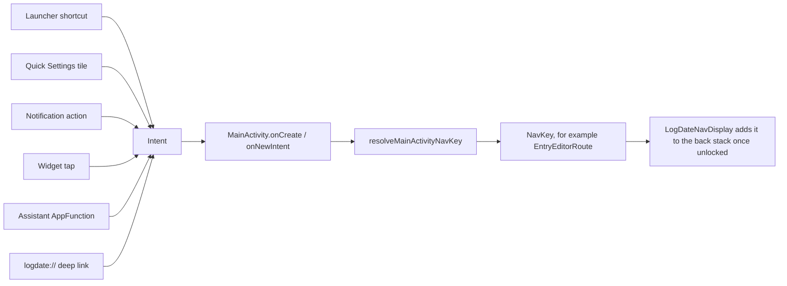

# Android OS Integration Guide

This guide explains how LogDate connects to Android outside its own screens: launcher shortcuts,
Quick Settings tiles, notifications, widgets, bubbles, keyboards, desktop windows, and assistants. It
is written for someone who has built Android screens before but has not worked with these system
surfaces.

The product decisions behind this work are in
[`docs/feature-design/android-os-integration.md`](../../feature-design/android-os-integration.md).
Progress and evidence for each surface are in
[`docs/audits/android-os-integration-checklist.md`](../../audits/android-os-integration-checklist.md).

## What an "OS surface" is

Most of an app's code draws its own screens. An OS surface is different: **Android draws it**, and the
app only describes what should appear and what should happen when the person taps it.

- A **launcher shortcut** is a label, an icon, and an `Intent`. The launcher shows it when the person
  long-presses the app icon.
- A **Quick Settings tile** is a `TileService` that the system binds to when the shade opens. The app
  sets the tile's label, icon, and active state; the system draws it.
- A **notification** is a `Notification` object. The system decides where it appears: the shade, the
  status bar, the lock screen, or a bubble.
- A **widget** is a `RemoteViews` layout that the launcher draws in its own process. LogDate builds
  them with Jetpack Glance.

Because the system draws these surfaces, there are two consequences for how they are built and
tested:

1. **The app is not running when the surface is tapped.** Every surface hands Android an `Intent` or a
   `PendingIntent`, and Android starts LogDate with it later. The intent must contain everything
   needed to reach the right screen.
2. **Ordinary Compose screenshot tests cannot see them.** That is why LogDate has a second screenshot
   lane that captures real system UI on emulators (see [Screenshots](#screenshots)).

## How a tap on a surface reaches a screen

Almost every surface ends up in the same place: an `Intent` delivered to `MainActivity`.



Here is what each step does:

1. **`MainActivity` receives the intent.** On a cold start this happens in `onCreate`, and when the
   app is already running it happens in `onNewIntent`. Both live in
   `app/compose-main/src/androidMain/kotlin/app/logdate/client/MainActivity.kt`.
2. **Shares and journal shortcuts take a side door.** `handleMultiWindowIntent` in
   `MainActivity+MultiWindow.kt` handles shares (`ACTION_SEND`) and share-to-journal shortcuts. It
   opens them in a separate `EditorActivity` window.
3. **Everything else is resolved to a route.** `resolveMainActivityNavKey` in
   `DeepLinkResolver.kt` reads the intent's action, extras, and data and returns a Navigation 3
   `NavKey`, such as `EntryEditorRoute`, `TimelineDetailRoute`, or `SearchRoute`.
4. **The route waits for the lock.** `LogDateNavDisplay` adds the pending route to the back stack only
   after onboarding is complete and the app lock is open. Surfaces can therefore start capture, but
   they cannot skip the lock to read the journal.

If you add a surface, you almost never add a new route. You add an intent that
`resolveMainActivityNavKey` already understands, or teach it one new case and test that case.

## The capture launch contract

Starting a new entry is the most common thing a surface does, so it has one shared contract. The
details are in [capture-launch-contract.md](os-integration/capture-launch-contract.md). In short:

- Send `app.logdate.action.CAPTURE` with an optional `mode` (`text`, `voice`, `camera`, `video`) and
  an optional `journal_id`.
- The resolver turns it into `EntryEditorRoute(launchMode = ...)`.
- The editor prepares the right first block for that mode.

## Surfaces

| Surface | Guide | What it covers |
| --- | --- | --- |
| Capture launch contract | [capture-launch-contract.md](os-integration/capture-launch-contract.md) | The shared intent and editor launch mode |
| Launcher shortcuts and Direct Share | [launcher-shortcuts.md](os-integration/launcher-shortcuts.md) | Static, dynamic, pinned, and sharing shortcuts |
| Quick Settings tiles | [quick-settings-tiles.md](os-integration/quick-settings-tiles.md) | New entry and Record voice tiles |
| Live Updates | [live-updates.md](os-integration/live-updates.md) | Promoted notifications for recording and progress |
| Notification quick reply | [notification-quick-reply.md](os-integration/notification-quick-reply.md) | Writing an entry from a capture nudge |
| Widgets | [widgets.md](os-integration/widgets.md) | Glance widgets on the home screen, lock screen, and hub |
| Bubbles | [bubbles.md](os-integration/bubbles.md) | App Bubbles and the recording bubble |
| Keyboard, pointer, drag and drop | [keyboard-pointer-drag-and-drop.md](os-integration/keyboard-pointer-drag-and-drop.md) | Shortcuts, right-click, tooltips, stylus, cross-app drag and drop |
| Large screens and desktop windowing | [large-screens-and-desktop-windowing.md](os-integration/large-screens-and-desktop-windowing.md) | Manifest attributes, windows, titles, caption bar |
| AppFunctions | [app-functions.md](os-integration/app-functions.md) | Assistant capture and consent-gated recall |

## Feature flags and manifest components

New surfaces stay hidden behind a `FeatureFlag` until they are verified. The flag table is in the
[design spec](../../feature-design/android-os-integration.md#feature-flags).

Some surfaces exist because the **manifest** declares them. A `<service>` for a tile and a
`<receiver>` for a widget are examples. Android shows these to the person as soon as the app is
installed, so checking a flag in Kotlin is not enough to hide them. LogDate handles these in two
steps:

1. Declare the component with `android:enabled="false"` in the manifest.
2. Register it with `PlatformComponentToggler`, which watches the flag and calls
   `PackageManager.setComponentEnabledSetting(..., DONT_KILL_APP)` when the flag changes.

The mapping from flag to components is `PlatformComponentToggler.osIntegrationComponents` in
`app/compose-main/src/androidMain/kotlin/app/logdate/client/platform/PlatformComponentToggler.kt`.
The app starts the toggler at launch, and it follows each flag from then on.

While a surface is being verified, its flag can be turned on in **Settings > Advanced > Developer
tools > Feature previews**. That works in every build, including release builds used for dogfooding.

When a surface ships to everyone, delete its flag. Then remove `android:enabled="false"` and the
toggler entry in the same commit.

## Screenshots

Every surface ships with screenshots in the same commit as the code. There are two lanes, because
Android draws some of these surfaces itself:

| Lane | What it captures | How | Where the images live |
| --- | --- | --- | --- |
| Lane 1 | LogDate's own Compose UI and Glance widget layouts | Compose preview screenshot tests and a host-side Glance renderer | `app/android-main/src/screenshotTestDebug/reference/`, plus the widget module's references |
| Lane 2 | Real system UI: shortcut popups, the shade, chips, bubbles, the lock screen | `OsSurfaceScreenshotsTest` on a Gradle Managed Device with SystemUI demo mode | `docs/screenshots/android-os-integration/<surface>/` |

The coverage registry (`config/screenshots/os-integration-coverage.txt`) lists the images each
feature must have. `checkOsIntegrationScreenshotCoverage` fails the build when one is missing or
stale. [`docs/testing/screenshot-tests.md`](../../testing/screenshot-tests.md) explains how to record
and review them.

## Testing on devices

Use only emulators whose `adb` serial starts with `emulator-`, or Gradle Managed Devices. Physical
devices are never test targets in this repository. A physical phone is often connected to the
development machine, so pass the serial explicitly:

```bash
adb -s emulator-5554 shell am start -a android.intent.action.VIEW -d "logdate://search?q=coffee"
```

Run instrumented tests through the managed-device tasks, for example:

```bash
./gradlew :app:android-main:smokeDevicesGroupDebugAndroidTest -Plogdate.androidTestClass=app.logdate.client.DeepLinkResolverTest
```

Never use `connectedDebugAndroidTest`.
