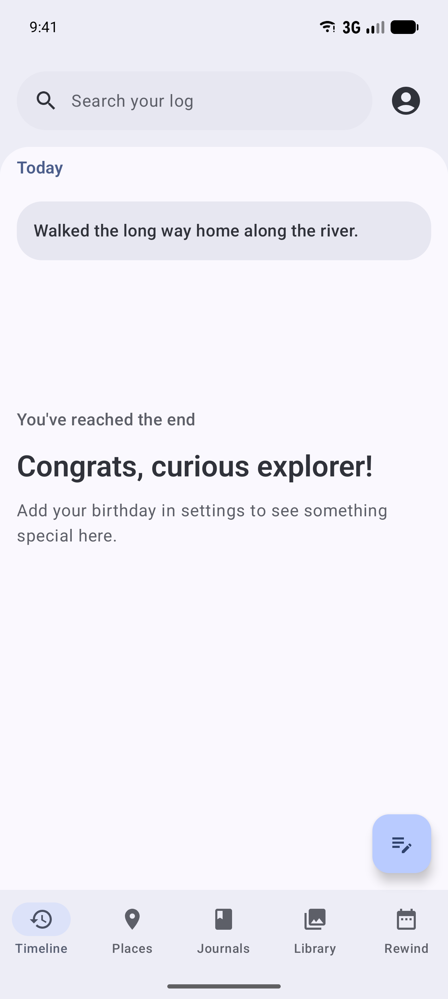
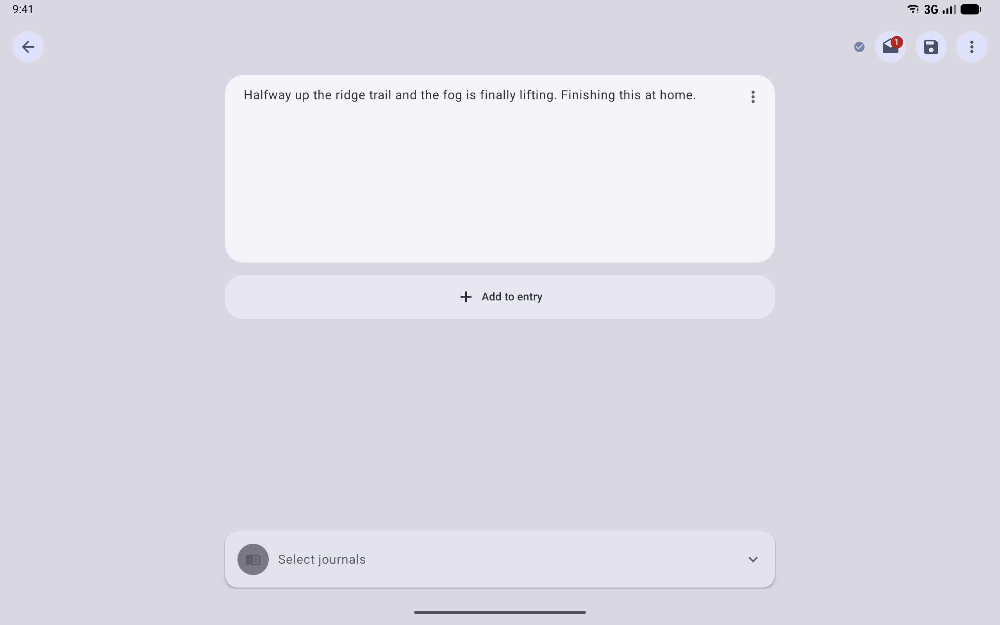
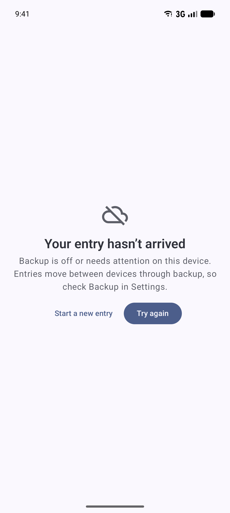

# AppFunctions

Status: built, behind `APP_FUNCTIONS` (Settings > Advanced > Developer tools > Feature previews), and
verified on an Android 17 emulator. Requires Android 16 (API 36) or later. Library:
`androidx.appfunctions` 1.0.0-alpha10.

## What it is

**AppFunctions** let an app offer actions to on-device agents and assistants, such as Gemini. An app
declares functions with typed parameters and results. Android registers them, and an agent can then
call them on the person's behalf. For example, "add to my journal that the hike was beautiful".

AppFunctions are an Android platform API with a Jetpack library, `androidx.appfunctions`. They replace
the older App Actions `<capability>` bindings that `shortcuts.xml` used to carry. Those bindings were
removed because they pointed at a class that no longer exists.

## What the person can ask for

| Function | What it does | Needs consent? |
| --- | --- | --- |
| `createTextEntry(text)` | Saves a text entry, dated now, and returns it | No |
| `listJournals()` | Returns each journal's id and title, so an agent can name one | Yes |
| `searchEntries(query)` | Returns up to 10 matching entries, best match first, each shortened to one line | Yes |

The entry an assistant saves appears in the timeline like any other:



Two functions from the original plan were left out on purpose:

- **`startVoiceEntry`.** An assistant calls a function from the background, and Android does not let a
  background call open an activity reliably. Voice entries start from the Record voice shortcut,
  tile, and widget instead.
- **`summarizeDay`.** It would hand over a whole day of writing at once. `searchEntries` returns only
  what matches, under the same consent.

## Consent and the app lock

Reading someone's journal is far more sensitive than adding to it. `listJournals` and
`searchEntries` check two things on every call:

1. **System search visibility.** The person controls this in Privacy settings. It is the same setting
   that lets LogDate entries appear in Android search, read through
   `LogdatePreferencesDataSource.getSystemSearchVisibilityEnabled()`.
2. **The app lock.** If the lock is on in Settings (`UserData.securityLevel`) and the person has not
   unlocked LogDate in this process (`BiometricGatekeeper` reports `AUTHENTICATED`), the call is
   refused. The setting is read directly because the gatekeeper starts every new process as "no
   prompt needed", including one Android starts just to answer an assistant.

A refusal throws `AppFunctionDeniedException` with a message that says which check failed and what the
person can do; it never returns partial data. The decisions are `assistantUnlocked` and
`assistantReadRefusal` (app/compose-main commonMain, `client/appfunctions/AssistantAccess.kt`), pure
functions with tests.

## How it works

- `LogDateAppFunctions` (app/compose-main androidMain, `client/appfunctions/`) is an abstract
  `AppFunctionService` annotated `@AppFunctionServiceEntryPoint`. Each function's KDoc is its
  description for agents (`isDescribedByKDoc = true`).
- The AppFunctions KSP compiler, applied to the module's Android target as `kspAndroid`, generates the
  concrete `LogDateAppFunctionService` and the schema asset `logdate_app_functions.xml`. The
  multiplatform Android library does not package KSP assets on its own, so `app/compose-main`'s build
  adds that folder to its assets; check that the APK contains `assets/logdate_app_functions.xml`.
- The app manifest declares the generated service with the `android.app.appfunctions.v2` property
  naming that asset, and an application-level `app_metadata` property pointing at
  `res/xml/app_functions_app_metadata.xml`, which tells agents what LogDate is and when to use each
  function.
- The functions call the same use cases the app uses: `AddNoteUseCase`, the current user's journals,
  and the search repository.

## Flag and rollout

`APP_FUNCTIONS`, off by default. The generated service is declared disabled and enabled by
`PlatformComponentToggler` while the flag is on, so Android only indexes the functions then. As of
mid-2026, Gemini calls AppFunctions only for apps in a private preview, so functions are verified
through Android's own registry.

## Privacy

- `createTextEntry` returns nothing from the person's journal beyond the entry it saved.
- `listJournals` and `searchEntries` follow the consent and lock rules above on every call. Journal
  titles count as journal content, and search returns short excerpts rather than whole entries.
- Whether the app lock is on comes from the lock setting, not from the unlock screen's state: a
  process Android starts only to answer an assistant has never shown that screen, so with the lock
  on, LogDate stays locked to assistants until the person unlocks it in the app.

## How to test

- `AssistantAccessTest` covers the consent and lock decision and the excerpts.
- `OsSurfaceScreenshotsTest#assistantActions` drives the functions on an Android 16+ managed device
  the way an agent would and saves the output as
  `docs/screenshots/android-os-integration/app-functions/assistant-actions--phone-api37.txt`: the
  registered functions, a saved entry, a refused search with consent off, and a successful search
  with consent on.
- By hand, on an emulator with the flag on:

  ```bash
  adb -s emulator-5554 shell cmd app_function list-app-functions
  ```

  ```bash
  adb -s emulator-5554 shell "cmd app_function execute-app-function --package studio.hypertext.logdate.debug --function 'app.logdate.client.appfunctions.LogDateAppFunctions#createTextEntry' --parameters '{\"text\":[\"A note from adb\"]}'"
  ```

  Each parameter is a one-element JSON array.

## Updating screenshots

`./run screenshots:os` records the text evidence and the timeline capture under
`docs/screenshots/android-os-integration/app-functions/`.

## Cross-device: Handoff

Android 17 Handoff lets an activity continue on another of the person's Android devices. While an
activity is open, Android shows its app icon on the person's other nearby devices; picking it there
opens the same activity on that device. `MainActivity` opts in (`MainActivity+Handoff.kt`); the web
fallback stays off until logdate.app can rebuild app state from a URL.

### Editor Handoff

With `EDITOR_HANDOFF` on, an editor window can move too: start an entry on the phone, pick LogDate on
the tablet, and the tablet opens the same unfinished entry.

The hard part is that Handoff carries only a small bundle of extras, never the entry itself. The entry
travels as a **draft** through backup's draft sync (`DraftUploader` and `DraftDownloader` in
`client/sync`), which normally runs on backup's schedule. So the two devices each do one extra thing:

- **The sending device** (`EditorActivity.onHandoffActivityDataRequested`) puts the draft's id in the
  extras (`EntryEditorViewModel.draftIdForHandoff`). Text that autosave has not saved yet is handed
  off under the id its first draft is about to be saved with (`DraftManager.reserveDraftId`), and
  that save starts at once. Android also asks while the window is closing, for a copy it keeps, and
  this way that copy names the draft even if autosave is still running. When the request is active,
  meaning the person just picked LogDate on the other device, it also saves the latest text and runs
  draft sync at once, instead of waiting for backup's schedule. An empty editor hands off as a new
  entry.
- **The receiving device** opens `EditorActivity` with that id (`EXTRA_HANDOFF_DRAFT_ID`).
  `HandoffDraftGate` opens the draft at once when it is already on the device. Otherwise
  `HandoffDraftReceiver` runs draft sync every few seconds for up to a minute, through the
  `DraftRefresher` interface that `SyncDraftRefresher` implements, while the editor shows that the
  entry is on its way. If it never comes, the editor says why, with a different message for backup
  being off, a sync error (with its message), and a draft the other device has not uploaded. Try
  again starts the wait over, and Start a new entry stops waiting.

| Opened from another device | When the draft has not arrived |
| --- | --- |
|  |  |

The flag only controls whether an editor offers itself to other devices. An editor that a handoff
launches always opens its draft, so a device with the flag off can still receive one.

**Testing.** `HandoffDraftReceiverTest` and `HandoffDraftGateTest` (editor module) cover waiting,
arrival, each missing reason, Try again, and Start a new entry. `EditorHandoffTest` and
`SyncDraftRefresherTest` (compose-main) cover the handed-off id and how a draft sync result maps to
a reason, and `DraftManagementTest` checks that unsaved text is handed off under the id its draft is
then saved with. `OsSurfaceScreenshotsTest#editorHandoff` runs both ends on one Android 17 managed device: it
types an entry, checks that the editor offers Handoff and that the offered extras name its draft
(saved as `editor-handoff-data--<device>-api37.txt`), then launches the editor with those extras the
way Android does on a second device. A real two-device handoff needs two devices signed in to the
same Google account and LogDate account, which managed emulators cannot provide; that check is the
flag's remaining step before it turns on.
