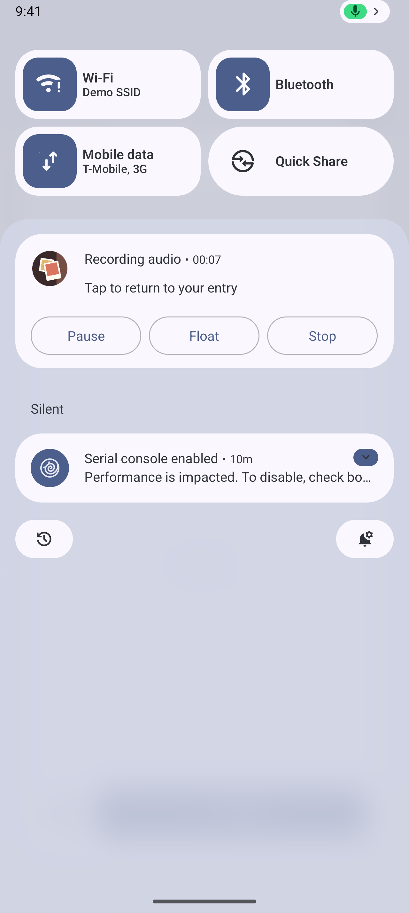
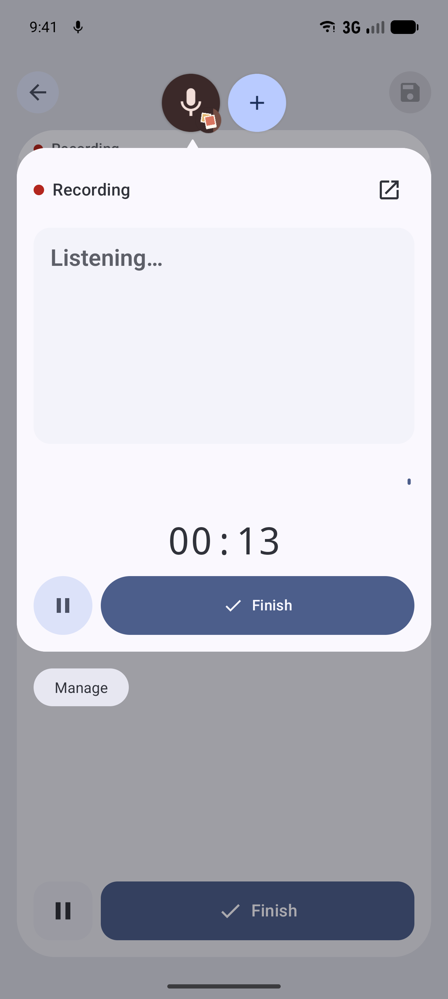
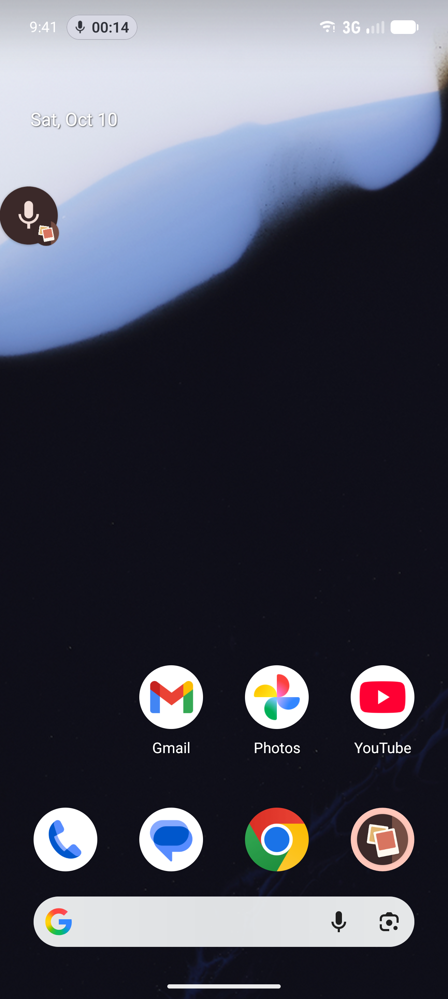
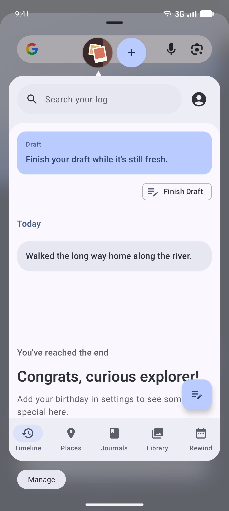
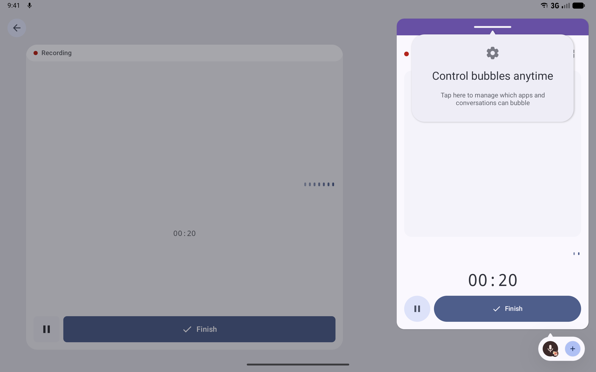

# Bubbles

Status: the recording bubble is built and verified on Android 16 and 17 emulators, behind
`RECORDING_BUBBLE` (Settings > Advanced > Developer tools > Feature previews). App Bubble readiness
ships without a flag and is verified on Android 17.

## What it is

A bubble is an app window that floats above other apps. It can be collapsed to an icon at the screen
edge and expanded into a small window. Android has two kinds:

| Kind | Who starts it | What it shows | Android version |
| --- | --- | --- | --- |
| **App Bubble** | The person, by long-pressing the app's launcher icon and choosing Bubble | The whole app, in a small floating window | Android 17 |
| **Notification bubble** | The app, by attaching `BubbleMetadata` to a notification | One activity the app chooses | Android 11+ |

On large screens, Android 17 also adds a **Bubble Bar** to the taskbar, where bubbles collect and can
be switched between.

LogDate uses both kinds:

- **App Bubble readiness.** Because people can bubble any app, Home and the editor must work in a
  bubble-sized window, and resizing must not restart them.
- **The recording bubble.** A floating recorder shows a voice entry as it records, with Pause or
  Resume and Finish, while the person uses another app.

## What the person sees

- **Bubbling LogDate:** the timeline and the editor fit in the bubble. Nothing important is clipped,
  and controls stay reachable.
- **Floating a recording:** while recording, a **Float** action appears on the recording
  notification. Tapping it floats the recorder as a bubble. Expanded, the bubble shows:
  - "Recording" or "Paused", with a button that opens LogDate;
  - the live transcript, when the bubble is tall enough (320dp or more);
  - the waveform and the elapsed time;
  - Pause or Resume, and Finish, which saves the recording to its entry.

  A Float action in the editor's voice block is planned.

Captured on Android 17 emulators (`./run screenshots:os`):

| The Float action | The floating recorder | Collapsed, with the Live Update chip |
| --- | --- | --- |
|  |  |  |

| LogDate as an App Bubble | The recorder in the tablet Bubble Bar |
| --- | --- |
|  |  |

The recorder's own layout, in every preview configuration and the 360×480dp bubble window, is the
Lane 1 reference set `Flow20_03_RecorderBubbleScreenshots.kt`.

## How it works

### App Bubble readiness

- `configChanges` on `MainActivity` and `EditorActivity` covers screen size, smallest screen size,
  screen layout, orientation, and density. Resizing a bubble then recomposes the UI instead of
  recreating the activity, so scroll position and in-progress text survive.
- Layouts are checked at bubble sizes, about 360×480dp and 320×400dp. The `Bubble` configuration in
  `@OsIntegrationPreviewMatrix` renders every OS-integration scene at that size.

### The recording bubble

A notification bubble must belong to a **conversation**: a notification with `MessagingStyle`, linked
to a long-lived sharing shortcut with a `Person`. LogDate's recorder is not a conversation, so the
design has to work within that rule:

1. **A long-lived shortcut.** LogDate publishes a long-lived "Voice recorder" shortcut, with a
   `Person` of the same name, when the person taps Float. It is removed when the recording ends.
2. **A separate bubble notification.** "Float" posts a second notification with:
   - `MessagingStyle`, linked to that shortcut;
   - `BubbleMetadata` pointing at `RecordingBubbleActivity`;
   - `setAutoExpandBubble(true)`, so it opens right away;
   - `setSuppressNotification(true)`, so no duplicate shade entry appears.
3. **The recorder activity.** `RecordingBubbleActivity` is declared with
   `android:allowEmbedded="true"`, `android:resizeableActivity="true"`, and
   `android:documentLaunchMode="always"`, which bubbles require. It draws `RecorderBubbleContent`
   (editor module) from the recorder's live streams, combined by `recorderBubbleStates`. Pause,
   Resume, and Finish send the recording service the same actions as the notification's buttons, so
   the bubble and the notification can never disagree.

The recording keeps its own foreground-service notification. That notification is a
[Live Update](live-updates.md), and a Live Update cannot use `MessagingStyle`, which is why the bubble
needs a notification of its own.

`RecordingBubbleNotifier` (app/compose-main androidMain, `client/bubble/`) posts and removes the
bubble. It watches the recorder and dismisses the bubble whenever a recording ends, however it ended.
Closing the bubble never stops or discards a recording.

The Float action lives in the media module, which cannot depend on the app. It reads
`RecordingBubbleSwitch` (client/notifications) to decide whether to show the action, and sends a
broadcast to `FloatRecorderReceiver` by class name. The app binds `FlagRecordingBubbleSwitch`, which
follows the flag.

Where the person has not allowed bubbles, Android shows the same notification in the shade as a
conversation, with the system's bubble button. The bubble's notification uses its own channel,
"Floating recorder", which allows bubbles.

### Spike result

Ship as designed. On the Android 16 and Android 17 phone emulators, Float turns the recorder into a
bubble that opens by itself; on the Android 17 tablet it lands in the Bubble Bar and opens from
there. The captures above come from `OsSurfaceScreenshotsTest#recordingBubble`, which allows bubbles
for LogDate first (`cmd notification set_bubbles`), as a person would in settings.

## Flag and rollout

- App Bubble readiness: no flag.
- Recording bubble: `RECORDING_BUBBLE`, off by default. `RecordingBubbleActivity` and
  `FloatRecorderReceiver` are declared disabled and enabled by `PlatformComponentToggler`. With the
  flag off, the recording notification has no Float action.

## Privacy

The bubble shows the live transcript of the recording in progress, the same text the editor shows
while recording. It never shows other entries. A collapsed bubble shows only the recorder icon, and
bubbles do not appear on the lock screen.

## Telling a bubble from any other window

Android 17 has one public way for an activity to learn it is in a bubble, `Activity.isLaunchedFromBubble()`, and it only covers bubbles the app opens itself. Measured on the Android 17 phone and tablet emulators:

| Bubble | Phone | Tablet | `isLaunchedFromBubble()` |
| --- | --- | --- | --- |
| The recorder, opened by LogDate through a notification | 395 × 480 dp, multi-window | 412 × 668 dp, multi-window | true |
| The whole app, bubbled by the person from the launcher | 395 × 718 dp, multi-window | 412 × 650 dp, multi-window | false |

So a screen LogDate opens as a bubble can lay itself out for a bubble with certainty. A launcher bubble of the whole app looks to `MainActivity` like any compact multi-window window, split screen included, so Home can respond only to the window it is given. `OsSurfaceScreenshotsTest#appBubble` and `#recordingBubble` record these facts each run in `bubbles/app-bubble-window--*.txt` and `bubbles/recorder-window--*.txt`.

## How to test

- `RecorderBubbleStatesTest` (editor, common) covers mapping the recorder's streams: neutral
  starting values, the waveform window, and following pause and transcript changes.
- `PlatformComponentTogglerTest` covers enabling the bubble components with the flag.
- On an API 37 emulator, long-press the LogDate icon and choose Bubble.

## Updating screenshots

- The recorder UI is a Lane 1 reference: `Flow20_03_RecorderBubbleScreenshots.kt`, recording and
  paused, in every `@OsIntegrationPreviewMatrix` configuration plus the 360×480dp bubble window.
- The real bubbles and the Bubble Bar are Lane 2 captures, recorded with `./run screenshots:os`.
  They land in `docs/screenshots/android-os-integration/bubbles/`.
