# Keyboard, Pointer, Drag and Drop

Status: partial.

- **Built:** the shared shortcut catalog (Compose handlers, Android's Meta+/ helper, and the desktop
  menu bar), right-click menus at the pointer, tooltips on the workspace account button, dropping
  text and media from other apps into the editor, dragging photos and videos out as real files, and
  writing in the editor with a pen.
- **Planned:** a new-window shortcut.

## What it is

Android runs on tablets with keyboards, Chromebooks, and desktop-windowing setups with a mouse. On
those devices people expect the same input conventions as any desktop app:

- **Keyboard shortcuts**, discoverable through the system shortcut helper (Meta+/ on Android, the
  menu bar on desktop).
- **Right-click** (secondary click) for the same menu a long-press opens.
- **Hover feedback and tooltips** on icon-only buttons.
- **Drag and drop between apps**: dragging a photo from Files into an entry, or a LogDate photo into
  a chat.
- **Stylus handwriting** in text fields.

## What the person sees

### Keyboard shortcuts

| Shortcut | Action | Where |
| --- | --- | --- |
| Ctrl+N | New entry | Anywhere |
| Ctrl+Shift+R | Record a voice entry | Anywhere |
| Ctrl+F | Search | Anywhere |
| Ctrl+, | Settings | Anywhere |
| Ctrl+S | Save entry | Editor |
| Esc | Close the editor | Editor |
| Ctrl+1 to Ctrl+5 | Open the first to fifth Home tab, in the order the navigation shows them | Home |

Planned: Ctrl+Shift+N for a new editor window.

On macOS desktop builds, Cmd replaces Ctrl. Pressing Meta+/ on Android lists all of these under
LogDate, here on a Pixel Tablet running Android 17 with a USB keyboard:

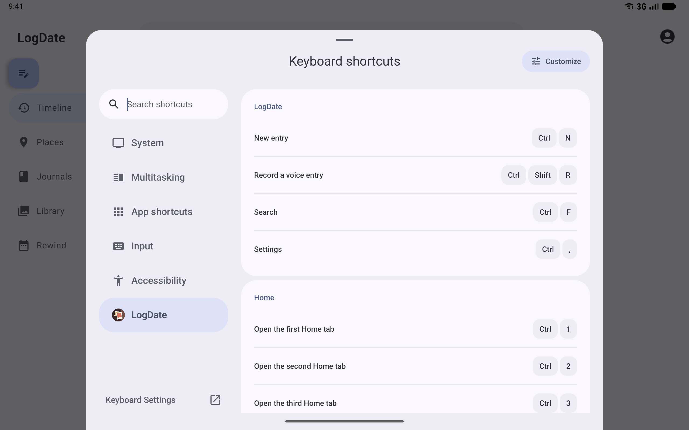

Android 17 gives the focused app its own category, with the app's icon, next to System and
Multitasking. It lists an app's shortcuts only for keys that the attached keyboard has.

### Pointer

- Right-clicking a journal cover, an entry in a day, a media thumbnail, or a postcard opens its menu
  at the pointer.
- Long-pressing a journal cover, an entry in a day, or a postcard opens the same menu without also
  opening the item. Long-pressing a media thumbnail starts a drag instead (see below), so its menu is
  on right-click.
- An entry's only action is "Open in new window", so it has no menu on devices that cannot open
  another LogDate window.
- Hovering an icon-only button shows a tooltip naming its action: the account button, the editor's
  Back, Drafts, Save, and More options buttons, and the Places sheet's expand and full-view buttons.
  A long press shows the same tooltip on touch. Screen readers read the same names.

A mouse resting on the account button in a desktop window's title bar:

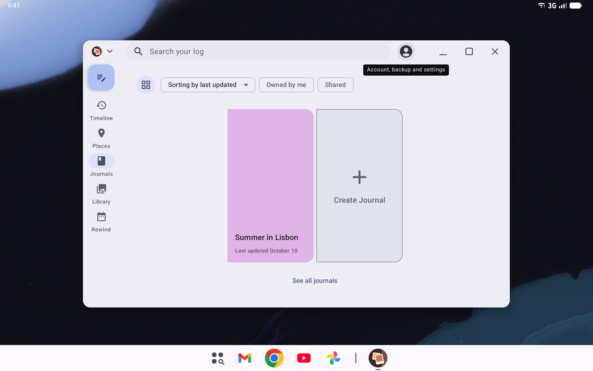

A long-press on a journal in the tablet's Journals carousel, on Android 17:

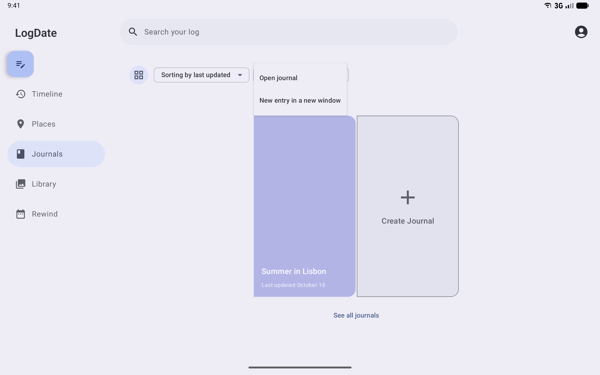

And on an entry in a day, opened beside the timeline:

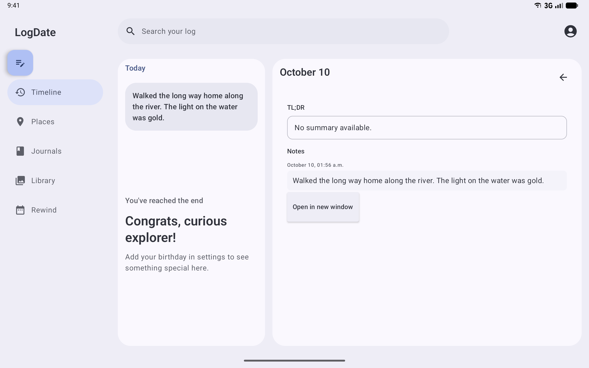

### Drag and drop

- Dropping text, photos, videos, or audio onto the editor adds them to the entry. A highlighted drop
  area shows while dragging over it.
- Pasting with a keyboard (Ctrl+V) adds a copied photo, video, or audio file to the entry on
  Android; any copied text is pasted into the text as usual. Pasting an image from the
  touch text menu, and GIFs from on-screen keyboards, do not work yet (see How it works).

A photo copied in another app and pasted with Ctrl+V on a tablet with a USB keyboard:

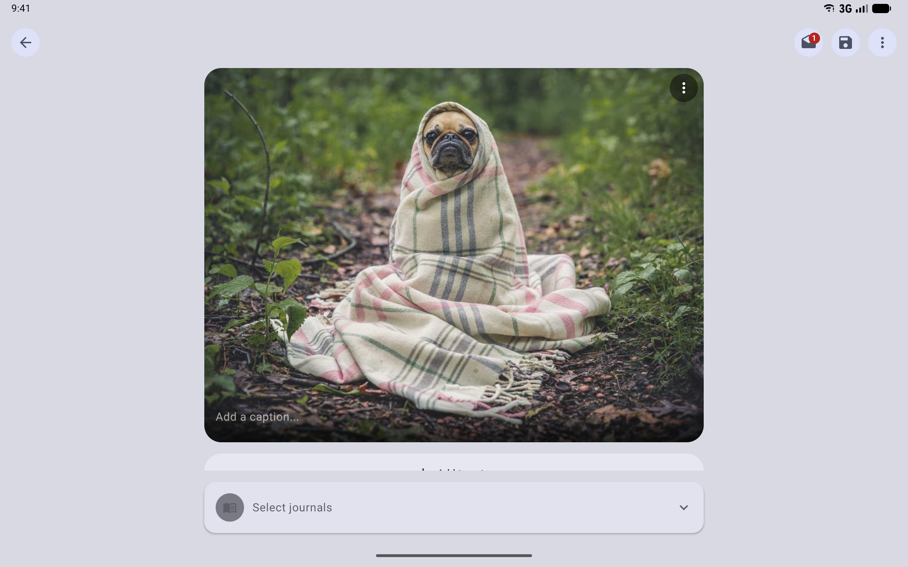

- Dragging a photo or video out of LogDate's Library sends the actual file, not a path string, to
  another app or to another LogDate window. A long press picks it up.

A photo dragged from the Library into a new entry in a second LogDate window on the Android 17
desktop:

| While dragging | Once dropped |
| --- | --- |
| 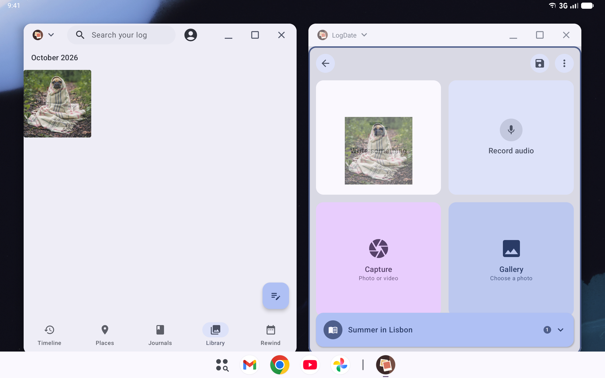 | 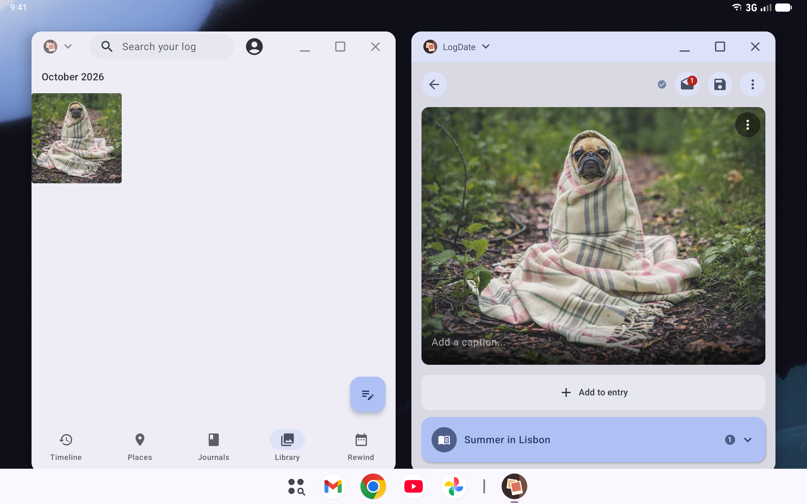 |

A photo dragged from the Files app into a new entry, with the two side by side on the Android 17
desktop. While it is over the editor, the editor is outlined in the theme's primary color:

| While dragging | Once dropped |
| --- | --- |
| 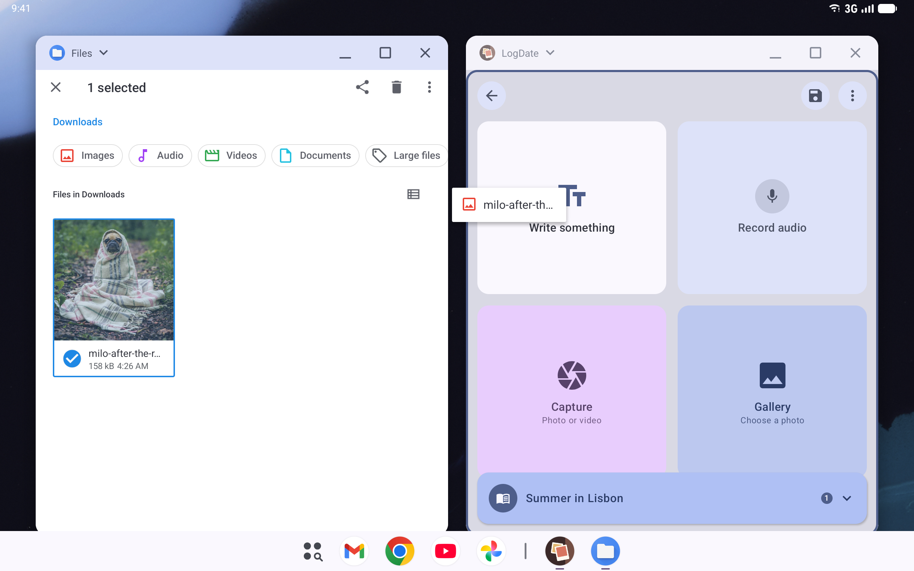 | 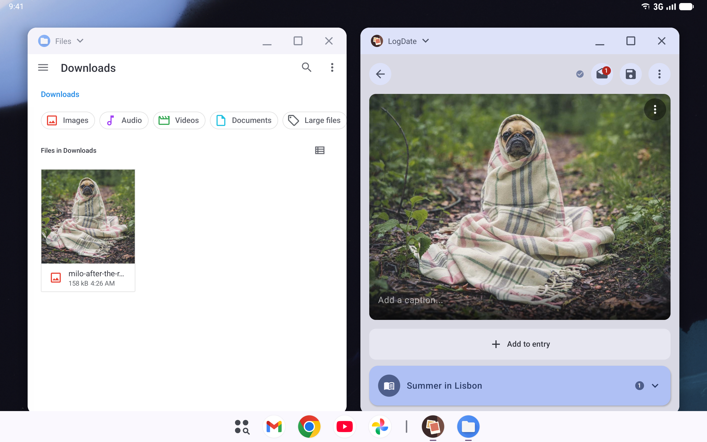 |

### Stylus

On Android 14 and later, writing with a pen over an entry's text turns the handwriting into typed
text, through the keyboard's handwriting mode (Gboard on most devices). The keyboard draws the ink
while the pen is down, then types what it read where the pen wrote, and shows its handwriting toolbar
instead of the on-screen keyboard.

"hello" written with a pen in a new entry on a Pixel Tablet running Android 17, while the pen is still
down:

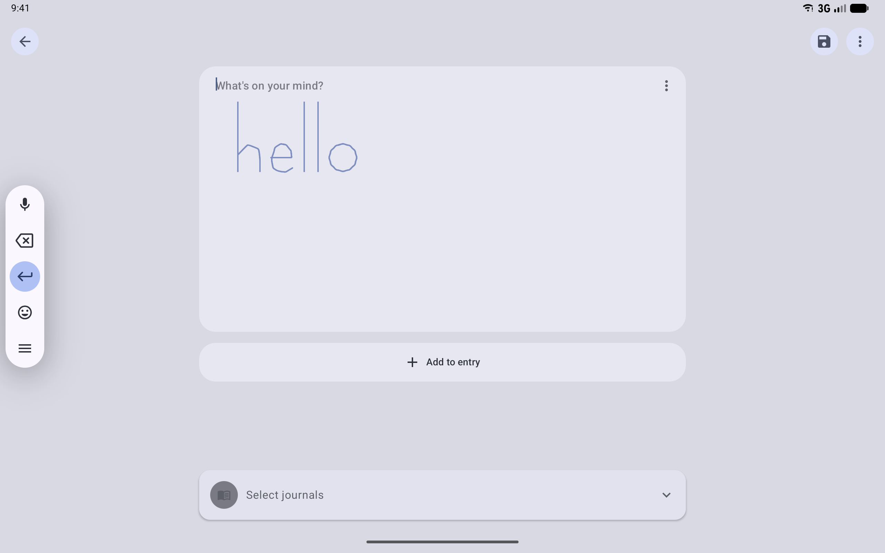

And once the pen lifts:

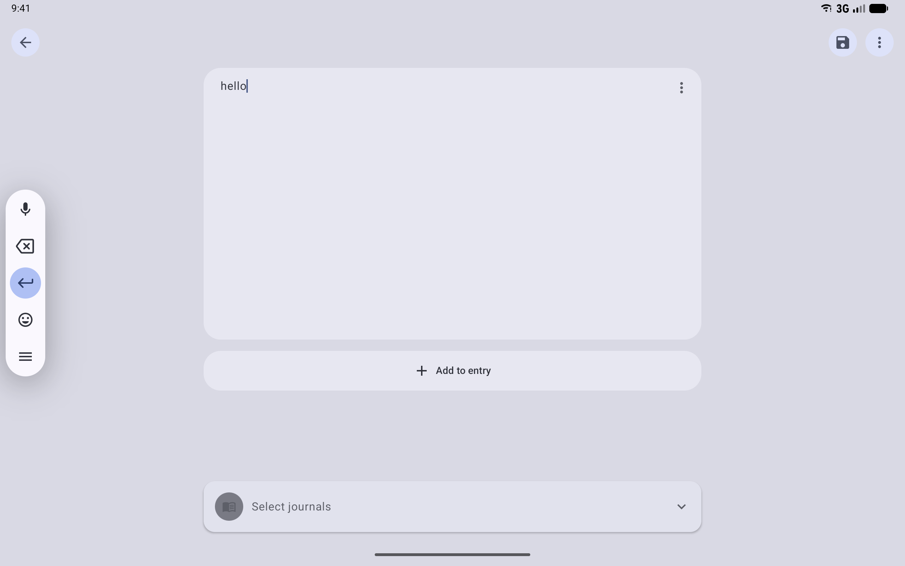

A person can also start writing on two controls that open a text field rather than being one:

- **The editor's "Write something" card.** Writing on it starts a text entry as soon as the pen
  touches it, and the handwriting is typed into that entry.
- **Home's search pill.** Writing on it opens search with the handwriting as the query.

| While writing | Once typed |
| --- | --- |
| 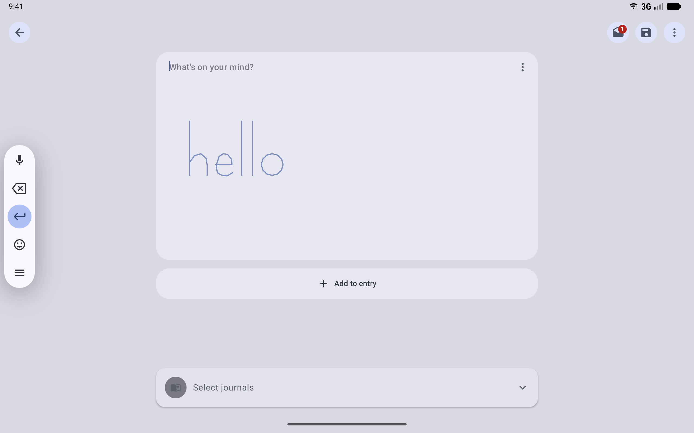 | 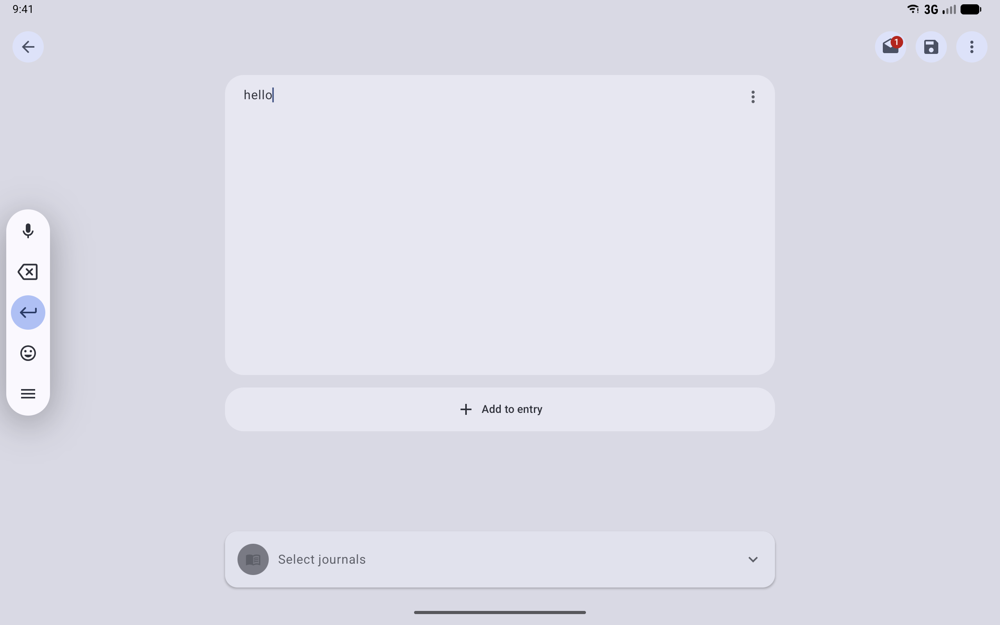 |
| 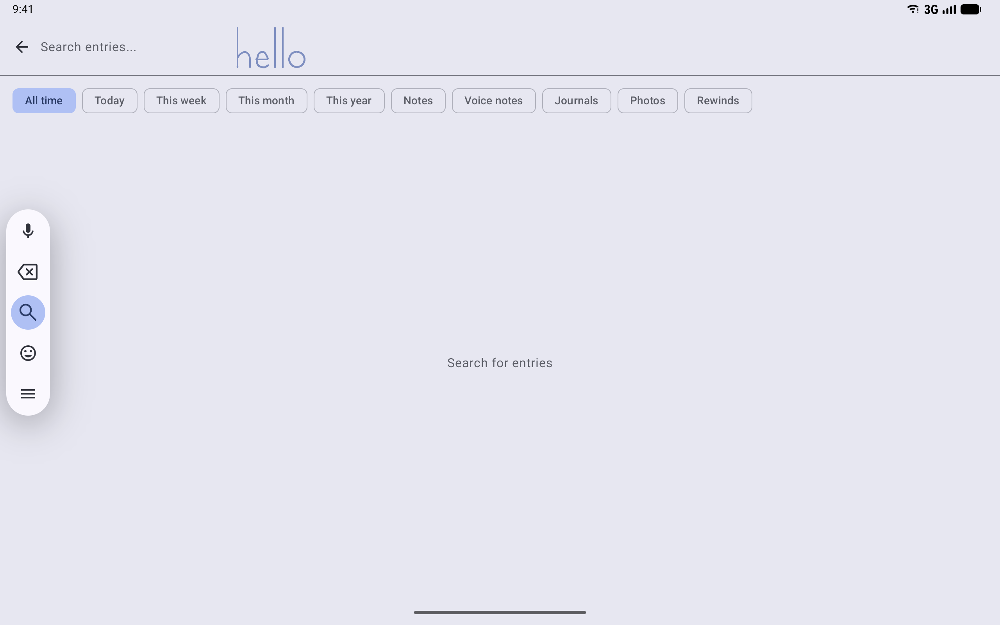 | 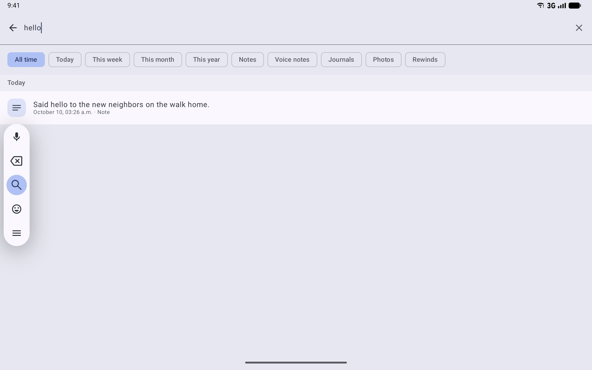 |

Menus and tooltips draw in popup windows, which preview screenshots cannot render, so their
screenshots are real captures from Android.

## How it works

### One shortcut catalog

`AppKeyboardShortcut` in `client/ui/src/commonMain/kotlin/app/logdate/ui/keyboard/AppKeyboardShortcuts.kt`
lists each action with its key chord, label, and scope (`App` or `Editor`). A chord's "primary"
modifier matches either Ctrl or Command, so one catalog works on every platform. Three places read
it, so a shortcut is defined once:

1. **The Compose key handler.** It replaces the single Ctrl+F handler in
   `app/compose-main/src/commonMain/kotlin/app/logdate/navigation/LogDateNavDisplay.kt` with a lookup
   in the catalog.
2. **`onProvideKeyboardShortcuts`** in `MainActivity` and `EditorActivity`. Android calls it when the
   person opens the shortcut helper, and `appKeyboardShortcutGroups` (client/ui androidMain) turns
   the catalog into `KeyboardShortcutGroup`s named "LogDate" and "Entry editor".
3. **The editor**, whose `EntryEditorContent` handles the `Editor` scope: Ctrl+S saves when the
   Save button would, and Esc behaves like the back button.
4. **Home**, whose `HomeScreen` handles the `Home` scope. Each tab shortcut carries a `homeTabIndex`,
   counted in the visible tabs, so Ctrl+4 still opens the fourth tab shown when Library is hidden.

Desktop builds get the `App` shortcuts through the same Compose handler, and the main window's menu
bar lists them: New entry and Record a voice entry under File, Search and Settings under Go.
`ShortcutItems` (app/compose-main desktopMain) labels each item and binds its accelerator from the
catalog, with Command as the primary modifier on macOS and Ctrl elsewhere. A menu item does not open
a screen itself; it sends the shortcut through `AppShortcutRequests` to `LogDateNavDisplay`, which
opens it with the same code as the keys (`AppKeyboardShortcut.appRoute`), so a menu item and its keys
cannot disagree, and both do nothing while LogDate is locked.

The editor's shortcuts are scoped to the editor, so they never fight with text editing keys.

### Right-click

`ContextMenuArea` is an expect/actual in `client/ui`. Android, desktop, and (until its native bridge
lands) iOS all use `MaterialContextMenuArea`, which opens on long-press and on a secondary click. A
right-click menu opens at the pointer: `contextMenuOffset` converts the click position into the
dropdown's offset from the item's bottom-left corner.

Long-press needs care because the content inside is usually clickable. Compose delivers pointer
events to the innermost element first in the normal (Main) pass, and a `clickable` card consumes the
press there, so a long-press detector on the wrapper in that pass never fires. The wrapper instead
watches the Initial pass, which runs outermost first, and consumes nothing until the press has lasted
the long-press timeout. Then it opens the menu and consumes the finger lifting, so the card does not
also count the press as a tap. If the finger moves past the touch slop after the menu opens, the menu
closes so a drag can take over. Content that uses long-press itself passes `openOnLongPress = false`.

Journal covers offer "Open journal", plus "New entry in a new window" where the device supports more
than one window, in both the journal list and the tablet carousel.

`IconTooltip` (client/ui) names icon-only controls on hover and long-press. The workspace account
button, the editor toolbar (`NoteEditorToolbar`), the Places supporting sheet, and the recorder
bubble use it. Wrap any new icon-only button in it, with the same label as its content description.

### Drag and drop

- **Into the editor.** `entryDropTarget` (editor module) accepts `text/*`, `image/*`, `video/*`, and
  `audio/*`; `routeDroppedItems` splits a drop into media and text and ignores anything else. Content
  URIs from other apps need `requestDragAndDropPermissions`, and that permission ends when released,
  so each file is copied into LogDate's private store through `ManagedMediaImporter` (the same path
  shared files use) before the permission is released. While an acceptable drag hovers, the editor
  draws a primary-color outline.
- **Pasting media.** `entryPasteTarget` (editor module) watches for the paste keys. When the
  clipboard holds media, it routes the clip through the same `routeDroppedItems` and import as a
  drop (`importIntoEntry`), and attaches the copies. It does not consume the keys, so the text field
  still pastes any text. Compose's `Modifier.contentReceiver`, which would also handle the touch
  paste menu and GIFs from on-screen keyboards, works only with the state-based `BasicTextField`
  (`TextFieldState`). The editor's text block stays on the value-based field because its inline
  Markdown styling is a `VisualTransformation`. The state-based field's `OutputTransformation` can
  change the displayed text but cannot add styles (Compose foundation 1.11), so moving the editor
  would drop its Markdown styling.
- **Out of LogDate.** `mediaDragSource` in `client/ui` sends a `ClipData` with a content URI from the
  app's FileProvider (`${applicationId}.provider`, which covers the private media store) and the
  file's MIME type. Stored media is named by `logdate-media://` references, so it first resolves the
  reference to its file with `MediaFileResolver`. It sets
  `DRAG_FLAG_GLOBAL | DRAG_FLAG_GLOBAL_URI_READ`, so the receiving app may read that one file.
  Library thumbnails use it. Compose starts the drag on a long press, so the modifier sits inside
  the thumbnail's `clickable`: outside it, the click takes the press first and the drag never
  starts.

### Stylus

LogDate has no handwriting code of its own. Since Compose foundation 1.7, every Compose text field
on Android 14 and later starts the platform's stylus handwriting when a pen moves over it, or within
40dp above or below and 10dp to either side. Compose asks the keyboard to start handwriting
(`InputMethodManager.startStylusHandwriting`), and the keyboard draws the ink and sends the text it
recognizes through the normal input connection, so the editor sees ordinary typing. The editor's text
block (`TextBlockContent.kt`) gets this for free.

Handwriting needs three things on the device: a pen (or an emulator touch screen that reports one),
a keyboard that supports handwriting, and the system setting "Use stylus to write in text fields",
which is on by default on devices that ship with a pen. Password fields never accept handwriting.

Some controls only open a text field: the editor's "Write something" card and Home's search pill.
Writing on those uses Android's handwriting delegation. `handwritingDelegator` (client/ui) marks the
control; when a pen starts writing on it, Android asks the keyboard to get ready for handwriting and
calls the control's callback, which opens and focuses a text field marked `handwritingDelegate`. That
field accepts the handwriting, and the keyboard types it there. On Android these are Compose's
`handwritingDetector` and `handwritingHandler`; desktop and iOS builds have no stylus handwriting, so
they do nothing there. The editor's text block and the expanded search field are the two delegates.
A field must be focused as soon as it appears, or the keyboard drops the handwriting.

Postcards have their own pressure-aware ink in `InkCapture.kt`; that is drawing, not text input.

## Flag and rollout

None. These are input fixes that apply wherever the hardware exists.

## Privacy

Dragging out shares only the file the person dragged, with read-only access granted for that drag.

## How to test

- **Unit tests:** the catalog has no duplicate chords per scope, and key events map to the right
  actions.
- **Compose UI tests:** `ContextMenuAreaTest` (client/ui desktopTest) checks that long-press over a
  clickable card opens the menu without clicking, a tap still clicks, right-click opens the menu, and
  content without items or with `openOnLongPress = false` keeps the press. `NoteEditorToolbarTest`
  (editor desktopTest) checks that hovering Save shows its tooltip and that screen readers hear the
  toolbar buttons by name.
- **Import tests:** MIME routing, partial-failure rollback, and a specific error for unreadable URIs.
- **Stylus:** `OsSurfaceScreenshotsTest#stylusHandwriting` writes "hello" with pen events and fails
  if the keyboard does not type it into the entry, and `stylusWritingOnControls` does the same on the
  "Write something" card and the search pill (see Updating screenshots).
- **Cross-app drag:** `OsSurfaceScreenshotsTest#crossAppDrag` drags a photo from Files into a new
  entry on the Android desktop and waits for it in the entry, and `#dragPhotoBetweenWindows` drags
  a Library photo into an entry in a second window.
- **Manual check:** on an API 37 tablet emulator with a hardware keyboard and mouse, press Meta+/.

## Updating screenshots

- Desktop menus, menus, tooltips, and drop states are Lane 1 references.
- The shortcut helper and stylus input are Lane 2 captures, recorded with `./run screenshots:os`. The
  cross-app drag and the account tooltip are recorded with `./run screenshots:desktop`, on the
  desktop windowing emulator, where windows sit side by side and a mouse pointer can hover; the
  tooltip capture rests the pointer with injected mouse hover events. They land in
  `docs/screenshots/android-os-integration/keyboard-pointer-drag-and-drop/`.
- The drag tests place the two windows with `am task resize` and drag with injected touch events
  (`OsSurfaceCapture.drag`): a press held past the long-press timeout, a steady move, and a pause
  over the target for the capture. `input draganddrop` does not hold long enough for Compose's
  drag source. In Files a first long press only selects a file; a drag starts from a file that is
  already selected. The Files app on the emulator does not accept files dropped from other apps,
  so the drag out of LogDate is shown into a second LogDate window, which receives the same shared
  file URI another app would.
- The shortcut helper capture plugs in a USB keyboard through Android's `uinput` shell tool
  (`HardwareKeyboard` in the instrumented tests). Key presses that UiAutomator injects come from
  Android's virtual keyboard, which has no physical keys, and Android 17's helper then drops every app
  shortcut. The test also switches the on-screen keyboards off while it captures, because the
  emulator's Gboard stays up next to a physical keyboard.
- The stylus captures write with `Stylus` in the instrumented tests. It sends pen motion events from
  one of the emulator's touch screens, which also reports itself as a stylus, at a pen's sampling
  rate (about 120 events a second). Speed matters: strokes sent slowly, for example one
  `adb shell input` command per point, reach the keyboard as separate words, and it reads them as
  something else. The tests turn on the handwriting setting and close Gboard's first-use stylus
  tutorial when it appears. A fresh managed device's Gboard has no handwriting model yet: it
  downloads one the first time a pen writes in a text field and ignores the pen until then. So the
  tests write one short stroke in a field, wait up to three minutes for the model (its pack appears
  in `dumpsys input_method`), clear the field, and put the on-screen keyboard away before writing.
