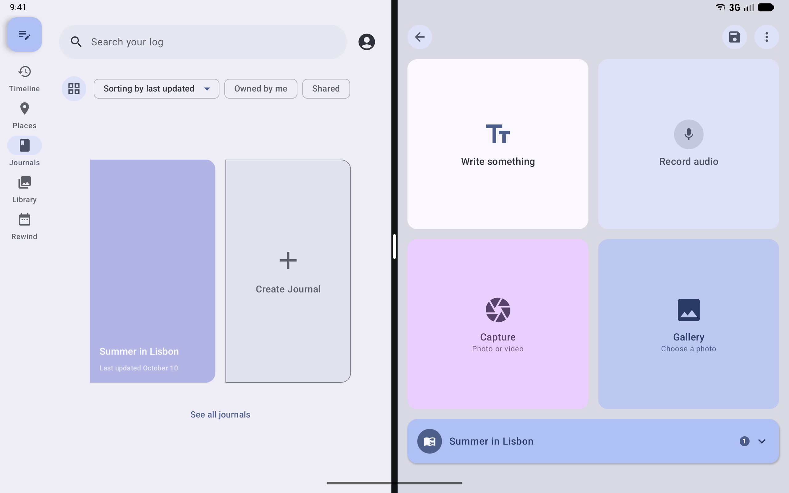
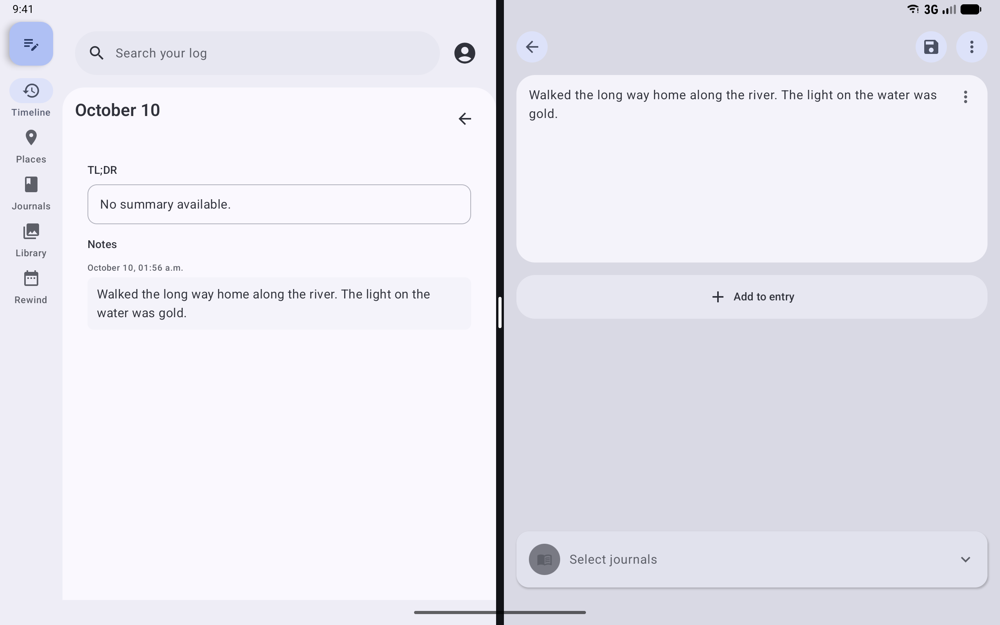
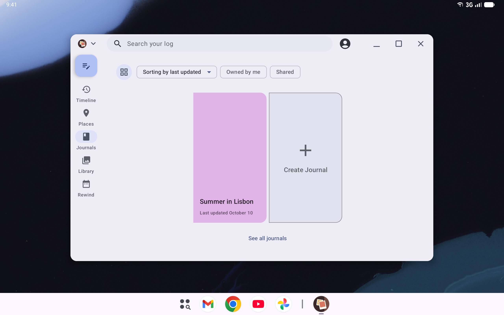
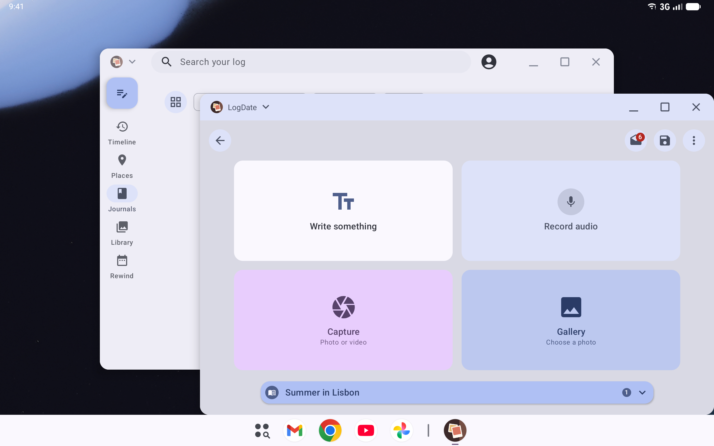

# Large Screens and Desktop Windowing

Status: partial.

- **Ships today:** the adaptive Home workspace, foldable postures, separate editor windows, video
  picture-in-picture, manifest hygiene, window titles, and "New entry in a new window".
- **Verified:** separate LogDate windows in Android 17 desktop windowing, with Home's search and
  account button in the window's caption bar.

## What it is

LogDate runs on phones, foldables, tablets, Chromebooks, and Android desktop windowing, where apps
open in resizable windows with title bars, much like a laptop. Three things matter on these devices:

1. **Any size, any time.** Apps targeting Android 17 (API 37) can no longer lock orientation or opt
   out of resizing on large screens. Windows are resized by dragging, snapping, and bubbling.
2. **Several windows.** People expect to open an entry in its own window, place two side by side, and
   tell windows apart in Recents and the taskbar.
3. **Window chrome.** In desktop windowing, the system draws a caption bar with close, maximize, and
   minimize controls. Apps can draw their own content into that bar instead of leaving it empty.

The layout system that adapts LogDate's screens to their space is documented in
[`docs/reference/architecture/home-workspace.md`](../../architecture/home-workspace.md). This guide
covers the window and system side.

## What the person sees

- **Chromebooks and desktops.** LogDate installs, and it does not assume a touchscreen.
- **Resizing.** A window can be resized, docked to a keyboard, or bubbled without losing what is on
  screen.
- **Window titles.** Each editor window carries its entry's first line as its label ("New entry" until
  there is text). Android 17's desktop caption bar shows the app's name, LogDate, instead of that
  label, so the label is not visible there.
- **New windows.** A journal's menu (its overflow menu, a long-press, or a right-click on its cover)
  offers "New entry in a new window", and an entry in a day offers "Open in new window" on a
  long-press or right-click. Either opens the editor beside LogDate in split screen when there is
  room. Launchers and the taskbar offer "New window" for the editor.
- **The caption bar.** In desktop windowing, Home's search and account button sit in the window's
  caption bar, between Android's app menu and its window buttons, and the window's background runs
  up behind them. Dragging any other part of the bar still moves the window. With text at 150% or
  larger, they stay in their usual row below the bar, where they fit.

"New entry in a new window" on a Pixel Tablet running Android 17, started from full screen. LogDate
keeps the left half, and the editor opens on the right, already filed to the journal:

An existing entry opened from its menu in a day, beside that day:

Home in a desktop window, recorded as Lane 1 references with stand-ins for Android's own caption
controls, in light, dark, right-to-left (where Android swaps the controls' sides), and a narrow
window:

| Light | Dark |
| --- | --- |
|  |  |
| **Right-to-left** | **Narrow window, Places** |
|  |  |

And on an Android 17 tablet emulator with desktop windowing on, where Android draws its app menu
(LogDate's icon) and window buttons itself:

## How it works

### Manifest attributes

All of these are in `app/android-main/src/main/AndroidManifest.xml`.

| Attribute | On | Why |
| --- | --- | --- |
| `<uses-feature android:name="android.hardware.touchscreen" android:required="false"/>` | app | Without it, Play treats a touchscreen as required and can hide the app on Chromebooks and desktops |
| `android:configChanges="screenSize\|smallestScreenSize\|screenLayout\|orientation\|density\|keyboard\|keyboardHidden\|navigation"` | `MainActivity`, `EditorActivity` | Resizing, rotating, bubbling, and docking a keyboard recompose instead of recreating the activity |
| `android:resizeableActivity="true"` | both (ships today) | Explicit, although API 37 enforces it on large screens |
| `<layout android:minWidth android:minHeight>` | `EditorActivity` | Stops the editor window from shrinking below a usable size |
| `<property android:name="android.window.PROPERTY_SUPPORTS_MULTI_INSTANCE_SYSTEM_UI" android:value="true"/>` | `EditorActivity` | Launchers and the taskbar offer "New window" |

Theme and dark-mode changes (`uiMode`) are deliberately left out of `configChanges`, so the theme
still reloads correctly.

### Windows

- `EditorActivity` is a separate document task (`documentLaunchMode="always"`,
  `taskAffinity=".editor"`), so each entry can have its own window.
- `EditorManager.openNewEditorWindow` and `openEntryInNewWindow` start it. Screens reach them
  through `EditorWindows` (`LocalEditorWindows`, client/ui), which `MainActivity` provides only where
  another window can open. Both actions pass the current activity as `adjacentTo` when the app is
  in multi-window mode or the window is at least 840dp wide. `EditorManager` then adds `FLAG_ACTIVITY_LAUNCH_ADJACENT` and starts
  the editor from that activity. On Android 12L and later, that request splits the screen even from
  full screen. The launch must come from the activity: from the application context, Android has no
  window to place the editor beside and opens it full screen.
- `EditorActivity` calls `setTaskDescription` with the entry's first line, which Android records as
  the window's label. The desktop capture saves the labels Android holds
  (`desktop-window-labels--tablet-api37.txt`): the editor window's is "New entry".

### The caption bar

Android 15 lets an app draw in its caption bar. The Home workspace shell does, in
`client/ui/.../workspace`:

1. `rememberPlatformCaptionBar` (androidMain) sets `APPEARANCE_TRANSPARENT_CAPTION_BAR_BACKGROUND`
   with `WindowInsetsController.setSystemBarsAppearance` while Home is on screen, and clears it when
   Home leaves, so other screens keep the standard bar. It also sets
   `APPEARANCE_LIGHT_CAPTION_BARS` when the workspace canvas is light, so Android draws its controls
   dark enough to read.
2. It reads the bar's height from `WindowInsets.captionBar`, and where Android's controls are from
   `WindowInsetsCompat.getBoundingRects(Type.captionBar())`: one rectangle for the app menu at one
   edge and one for the window buttons at the other. These are screen sides, not reading-direction
   ones, so `WorkspaceCaptionBar` keeps them as `left` and `right`.
3. `WorkspaceScaffold` stops padding its content for the caption bar and puts
   `WorkspaceCaptionAppBar` in it: search, at the bar's height less 8dp, and the account action,
   padded clear of both rectangles.
4. A press in the caption bar normally starts dragging the window. The search pill and the account
   action use `Modifier.systemGestureExclusion()` (`captionBarControl`), which tells Android to send
   presses there to LogDate; the rest of the bar still drags.

If the bar is shorter than 40dp, or the text is at 150% or more, the app bar stays below the bar, so
search and the account action never shrink below a readable size. Desktop and iOS builds have no
caption bar to share and keep the standard layout.

These changes are covered by the Home workspace contract (`checkHomeWorkspaceContract`) and
`WorkspaceCaptionBarTest` (client/ui desktopTest), which checks that search and the account action
fit inside the bar and clear both sides' controls, that content starts below it, and that large text
and windows without a caption bar keep the usual app bar.

### Desktop windowing evidence

Desktop windowing cannot be captured on a Gradle Managed Device. The Android 17 tablet image ships
with desktop windowing off; turning it on takes the "Enable desktop windowing" developer setting, a
system property that lifts the device check, and a restart. A managed device cannot restart in the
middle of a run, and starting LogDate with `am start --windowingMode 5` there opens it full screen.

`./run screenshots:desktop` (`scripts/desktop-windowing-screenshots.sh`) captures it on a regular
emulator instead. It creates an Android 17 Pixel Tablet emulator the first time, turns desktop
windowing on and restarts it, installs the debug app and its tests, and runs
`OsSurfaceScreenshotsTest#desktopWindows` and `#crossAppDrag` (a photo dragged from Files into an
entry, documented in the keyboard, pointer, and drag and drop guide). Both skip everywhere else,
because they run only when the script passes `logdate.desktopWindowing=true`. The emulator keeps its
data between runs, so the tests reuse one journal and one Downloads photo, and close the Files window
before capturing.

The main window, and a new entry opened from a journal's menu as a second window:

## Flag and rollout

None. These are platform requirements and fixes.

## Privacy

An editor window's label holds the first line of its entry. Android 17 does not show it in the caption
bar or Recents, but a launcher that lists task labels would, as it would for any document app.

## How to test

- A merged-manifest check asserts the attributes above.
- **Manual check:** on an API 37 tablet emulator, resize the window, dock a keyboard, and switch dark
  mode. The editor keeps its text and scroll position, and the theme updates.
- `MultiWindowEditorE2ETest` covers separate editor windows on managed devices.

## Updating screenshots

- The caption bar scenes are Lane 1 references in `HomeWorkspaceScreenshots.kt`
  (`WorkspaceTimelineInDesktopWindow`, `WorkspaceLocationsInDesktopWindow`), recorded with
  `./gradlew :app:android-main:updateDebugScreenshotTest --tests "*HomeWorkspaceScreenshotsKt.Workspace*InDesktopWindow*"`.
- Side-by-side windows are Lane 2 captures, recorded with `./run screenshots:os`. Desktop windowing
  is recorded with `./run screenshots:desktop`, because it needs its own emulator (see above). Both
  land in `docs/screenshots/android-os-integration/large-screens-and-desktop-windowing/`.
