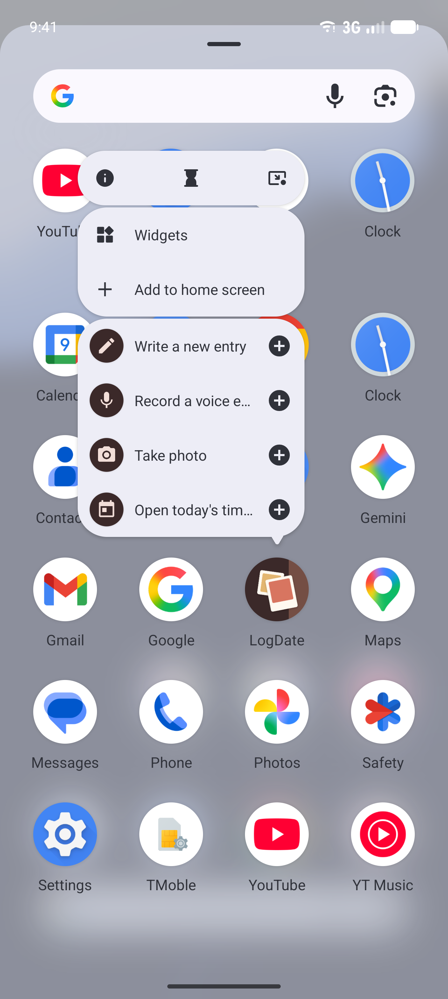
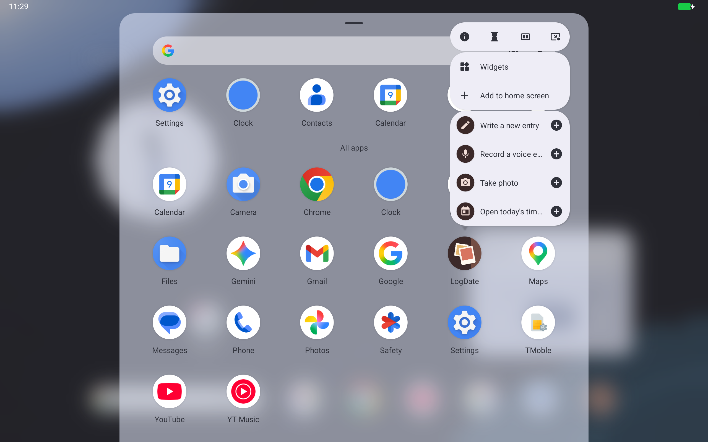
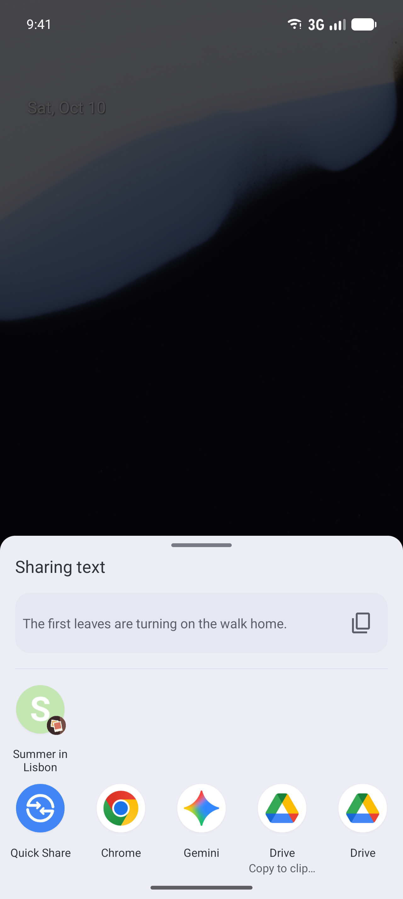
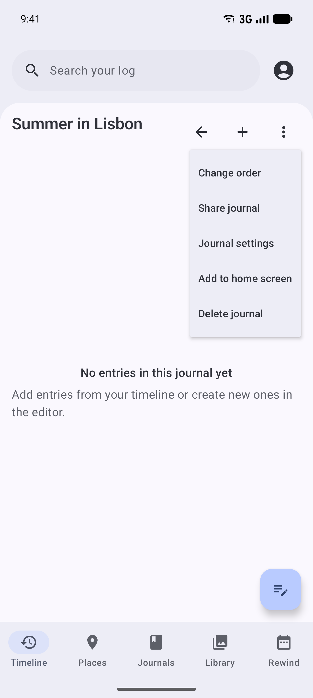
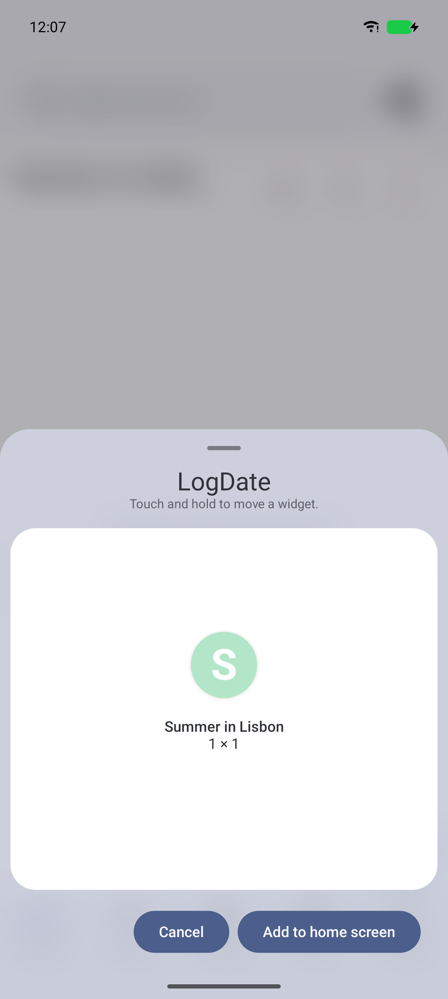

# Launcher Shortcuts and Direct Share

Status: partial. New entry, Record voice, and Take photo static shortcuts, the dynamic shortcuts,
Direct Share, usage reporting, and pinning journals to the home screen ship.

## What it is

When someone long-presses an app icon, the launcher shows a short menu of **shortcuts**. Each one is
a label, an icon, and an `Intent`. Android has three kinds:

| Kind | Declared | Changes at runtime? | LogDate uses it for |
| --- | --- | --- | --- |
| Static | `res/xml/shortcuts.xml` | No | Starting an entry: New entry, Record voice, and Take photo |
| Dynamic | `ShortcutManagerCompat` at runtime | Yes | Continue draft, Today, Last week, and one share target per journal |
| Pinned | `requestPinShortcut`, after the person agrees | Owned by the person once placed | Journals on the home screen (planned) |

**Direct Share** reuses dynamic shortcuts. A shortcut marked long-lived, with the
`android.shortcut.conversation` category and a matching `<share-target>` in `shortcuts.xml`, appears
as a target in the Android share sheet. LogDate publishes one per journal, so a photo can be shared
straight into "Travel" without opening the app first.

Launchers show only about four or five shortcuts in total, so which shortcuts appear matters more than
how many exist.

## What the person sees

- **Long-press the LogDate icon:** New entry, Record voice, and Take photo, each opening the editor
  already in that mode, plus one dynamic shortcut. That is Continue draft when a draft changed in the
  last 7 days, otherwise Today. The icons are adaptive icons with a monochrome layer, so launchers
  with themed icons recolor them to match the wallpaper.
- **Share sheet:** recently used and favorite journals appear as Direct Share targets, named for
  the journal and marked with LogDate's icon.
- **Home screen:** a journal's menu offers "Add to home screen", and Settings > Widgets adds widgets
  (see Pinning below).

| Android 17 phone | Android 17 tablet |
| --- | --- |
|  |  |

Every shortcut icon is an adaptive icon in the launcher icon's brown, with a monochrome layer for
themed icons.

Text shared from another app on an Android 17 phone, with the Summer in Lisbon journal offered as a
Direct Share target above the apps:



A share target has only a short label, the journal's name. The share sheet shows a shortcut's long
label when it has one, and "Share to Summer in Lisbon" did not fit its two short lines.

## How it works

### Static shortcuts

`app/android-main/src/main/res/xml/shortcuts.xml` is attached to `MainActivity` through
`<meta-data android:name="android.app.shortcuts">`.

- Each `<shortcut>` uses `@string/logdate_application_id` as its target package. That string is
  generated per build variant, so debug (`.debug`) and release builds both point at themselves.
- Each static shortcut sends the [capture launch contract](capture-launch-contract.md) intent:
  `app.logdate.action.CAPTURE` with `mode` set to `text`, `voice`, or `camera`.
- The icons (`ic_shortcut_new_entry`, `ic_shortcut_record_voice`, `ic_shortcut_take_photo`) are
  adaptive icons on the launcher icon's brown, with the glyph reused as the monochrome layer.
- **Shortcut ids are permanent.** A person may have pinned a static shortcut, so changing its id
  orphans the pinned copy.

### Dynamic shortcuts

1. **Decide.** `DynamicShortcutPublisher` (`client/feature/android-widgets/src/commonMain/.../shortcuts/`)
   chooses what to publish. It is pure Kotlin with no Android types, so it is unit-tested in
   `commonTest`. It returns `DynamicShortcutDescriptor` values: `ContinueDraft`, `TodayTimeline`,
   `WeekRewind`, and `ShareToJournal`.
2. **Apply.** `AndroidDynamicShortcutApplier` (`app/compose-main/src/androidMain/.../shortcuts/`) turns
   descriptors into `ShortcutInfoCompat` and publishes them. Share targets are ranked from 100 up, so
   they never displace launcher shortcuts.
3. **Refresh.** `DynamicShortcutRefreshObserver` watches drafts, rewinds, and journals (debounced
   500 ms). `DynamicShortcutRefreshWorker` re-publishes, scheduled daily by `DynamicShortcutScheduler`.

Launchers show four shortcuts. The publisher's cap is that number minus the three static
shortcuts, so it decides which dynamic shortcut appears instead of the launcher trimming silently.

A shortcut that a running surface depends on survives each refresh. The floating recorder's
"Voice recorder" conversation shortcut is the one case today: the applier republishes it alongside
the new set, so a refresh during a recording never orphans the bubble.

Share targets carry a `LocusId` equal to their shortcut id, which Android uses to connect the share
target with the journal it opens.

Drafts stay in the atomic `setDynamicShortcuts` call rather than moving to `pushDynamicShortcut`.
Shortcut ids are stable across refreshes, so usage history is not lost, and one atomic call cannot
leave launcher and share shortcuts half-updated.

### Usage reporting

Android asks apps to call `reportShortcutUsed` whenever the person does what a shortcut does, whether
or not they used the shortcut. Launchers use these reports to predict which shortcut to offer, and
the share sheet uses them to order journals.

When an entry is saved, `EntryEditorViewModel` passes what it captured and which journals it went to
to a `CaptureUsageReporter` (editor module; it does nothing outside Android).
`AndroidCaptureUsageReporter` reports:

- the static shortcut for each kind of capture in the entry, from `captureShortcutId`: writing
  reports New entry, voice reports Record voice, and a photo reports Take photo;
- the share target of each journal the entry was saved to.

A failed report is logged and never affects the save.

### Pinning a journal

A journal's menu offers **Add to home screen** wherever the launcher accepts pinned shortcuts. The
launcher shows its own confirmation with the shortcut's icon and name; nothing is pinned until the
person agrees.

| The journal menu | The launcher's confirmation |
| --- | --- |
|  |  |

- `HomeScreenPins` (client/ui, `common/HomeScreenPins.kt`) is the platform-neutral interface,
  provided through `LocalHomeScreenPins`. Where it is absent or `canPin` is false, the menu item
  does not appear.
- `AndroidHomeScreenPins` (app/compose-main androidMain, `shortcuts/`) builds a shortcut that opens
  `logdate://journal/{id}` and calls `ShortcutManagerCompat.requestPinShortcut`. Its id,
  `logdate.shortcut.journal:{id}`, is separate from the journal's share target.
- The icon comes from `JournalShortcutIcons`, which share targets also use: the journal's cover
  photo, or the colored monogram the in-app journal cover shows.
- These icons are bitmaps. Share targets are long-lived shortcuts, and Android 17 logs
  "Bitmaps are not allowed in long-lived shortcuts" each time they are published, but still
  publishes them with their icons. Android's own code marks this as a future error. Moving to the
  icon types it asks for means either a resource icon, which loses the journal's cover, or a
  content URI the launcher can read, which would expose journal covers outside LogDate, so it is
  left as is until Android enforces it.

Widgets are pinned from Settings > Widgets, through `AndroidMemoriesWidgetInstallController`.

### Direct Share intake

When a Direct Share target is chosen, `MainActivity` receives `ACTION_SEND` with
`Intent.EXTRA_SHORTCUT_ID` set to `logdate.shortcut.share_to_journal:<journal uuid>`. Then:

1. `IncomingShare.kt` parses the journal and imports the shared media.
2. `EditorManager.openNewEditorWindow` opens it in an `EditorActivity` window with that journal
   selected.

## Flag and rollout

None. Shortcuts change existing behavior and ship directly.

## Privacy

- Shortcut labels show journal names, never entry content.
- Journal cover images used as share-target icons come from the journal's own cover.

## How to test

- `DynamicShortcutPublisherTest` (commonTest) covers the selection rules.
- `SharingShortcutParsersTest` (androidHostTest) covers the shortcut id format.
- On an emulator, list published shortcuts:

  ```bash
  adb -s emulator-5554 shell cmd shortcut get-shortcuts --user 0 studio.hypertext.logdate.debug
  ```

## Updating screenshots

The launcher popup and the share sheet are system UI, so they are Lane 2 captures in
`OsSurfaceScreenshotsTest`. Record them with `./run screenshots:os`. They land in
`docs/screenshots/android-os-integration/launcher-shortcuts/`. The journal overflow menu and widget
settings are Lane 1 Compose references.
