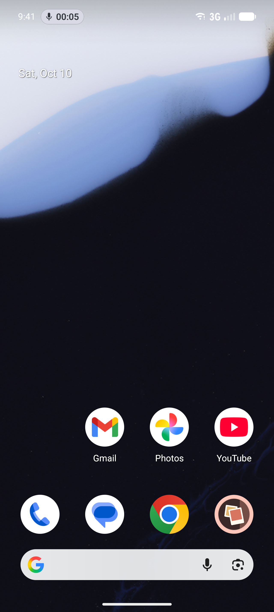
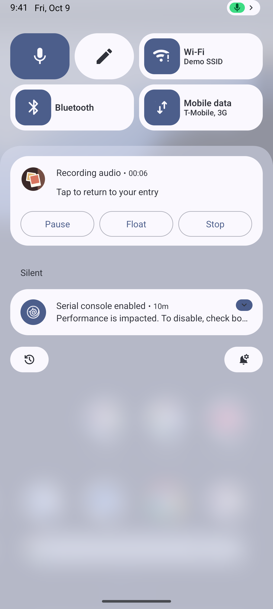
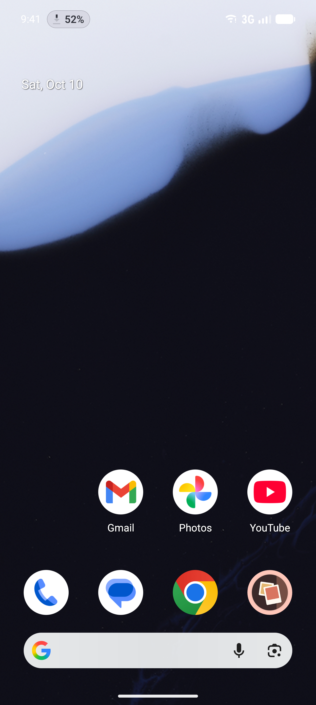
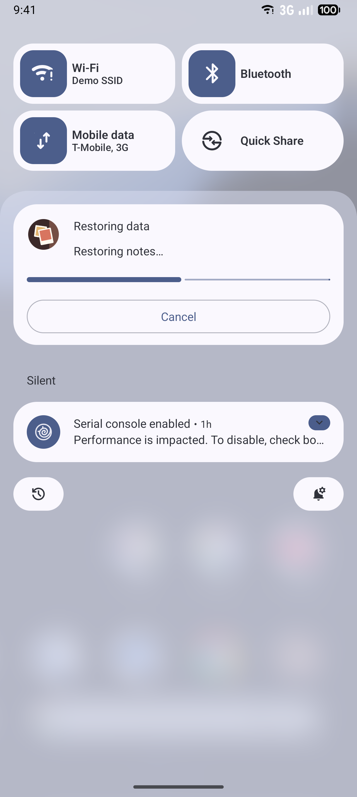

# Live Updates

Status: recording, export, restore, and sync progress are built, behind `LIVE_UPDATES` (Settings >
Advanced > Developer tools > Feature previews).

## What it is

A **Live Update** is an ongoing notification that Android promotes to more visible places:

- a chip in the status bar;
- the top of the notification shade;
- the lock screen and always-on display.

Android 16 introduced Live Updates for activities the person started and is actively waiting on, such
as a ride, a delivery, or a timer. A voice recording, an export, a restore, and a sync all fit.

The app does not draw a Live Update; it asks for one. A notification is eligible for promotion when:

- it is ongoing, has a title, and requests promotion (`setRequestPromotedOngoing(true)`);
- it uses the standard, `BigTextStyle`, `CallStyle`, or `ProgressStyle` style, with no custom views
  and no colorization;
- the app declares `android.permission.POST_PROMOTED_NOTIFICATIONS`.

The person can turn promotion off per app in system settings. The notification then shows normally.

## What the person sees

| Work | Status bar chip | Expanded notification |
| --- | --- | --- |
| Voice recording | A microphone icon and the elapsed time | Elapsed time, with Pause and Stop |
| Export | Percent complete, once known | Progress, then completion or a specific failure |
| Restore | Percent complete, once known | Progress split into the restore's phases, then completion or a specific failure |
| Sync | Percent of entries backed up, once known | Progress, then completion or a specific failure |

When the work finishes or fails, the notification stops being a Live Update: the chip goes away and
the notification drops into the shade's normal list, where the person can tap it or swipe it away.

| The status bar chip | The promoted notification |
| --- | --- |
|  |  |

A restore in progress, on the same phone. The chip shows the percent done, and the bar is split into
the restore's phases:

| The status bar chip | The promoted notification |
| --- | --- |
|  |  |

`transfer-finished--phone-api37.png` shows the finished and failed notifications that follow.

Android shows the chip only while LogDate is not on screen. The capture also records Android's own
verdict on the notification in
[`recording-promotion--phone-api37.txt`](../../../screenshots/android-os-integration/live-updates/recording-promotion--phone-api37.txt):
the app may promote, the notification qualifies, and it was promoted. The Android 16 emulator image
predates the chip, so its captures show the notification only.

## How it works

- **Recording.** `AndroidAudioNotificationHandler`
  (`client/media/src/androidMain/kotlin/app/logdate/client/media/audio/`) builds the recording
  notification, which already counts up with `setUsesChronometer`. With the flag on it also calls
  `setRequestPromotedOngoing(true)`. While recording, the status bar chip shows the chronometer's
  elapsed time; while paused, `setShortCriticalText` makes the chip say "Paused". The decision is
  `recordingLiveUpdate` in `client/notifications`, a pure function with tests.
- **The switch.** Notification code reads `LiveUpdatesSwitch` (client/notifications) instead of the
  flag store. The app binds `FlagLiveUpdatesSwitch`, which follows the `LIVE_UPDATES` flag; anywhere
  no switch is bound, Live Updates stay off.
- **Progress.** The export and restore notifications (`DataTransferNotificationHelper`,
  client/feature/core androidMain) and the cloud-sync notification (`SyncForegroundNotification`,
  client/sync androidMain) call `applyTransferLiveUpdate` (client/notifications androidMain). With the
  flag on, it requests promotion, puts the percent in the chip with `setShortCriticalText`, and
  switches to `NotificationCompat.ProgressStyle`. Restore passes the progress value where each of its
  phases begins, and `progressSegmentLengths` turns those into segments, so the bar shows which phase
  the restore is in, not just how much is done. The decision, `transferLiveUpdate`, is a pure function
  with tests. Work is promoted as soon as it starts; the chip shows a percent once progress is known.
- **No semantic colors.** Android 17 adds `Notification.createSemanticStyleAnnotation`, which marks
  text as safe (green), danger (red), and so on. Android applies it only to promoted notifications
  (the SDK's documentation says so, and an Android 17 emulator confirmed it). A finished or failed
  transfer is no longer promoted, so coloring its title would do nothing; LogDate leaves it plain.
  If a transfer ever reports a problem while it is still running, that text could carry the danger
  style, since the notification is still a Live Update then.
- **Library.** `androidx.core` 1.18 provides the compat builders and `ProgressStyle`; the media and
  notifications modules depend on it directly, because transitive versions predate these methods.

The notification channels are defined in `client/notifications/.../LogDateNotificationChannels.kt`.

## Flag and rollout

`LIVE_UPDATES`, off by default. With the flag off, every notification is built exactly as before.

## Privacy

The status bar chip and the lock-screen view show only time and progress, never entry text.

## How to test

- Host tests compare the builder output with the flag on and off: the promotion request, the chip
  text, the actions, and the segments.
- On an API 36 or 37 emulator, start a recording and look for the chip.

## Updating screenshots

Live Updates are system UI, so they are Lane 2 captures. Demo mode fixes the clock, so the chip text
is stable. Record them with `./run screenshots:os`. They land in
`docs/screenshots/android-os-integration/live-updates/`.
