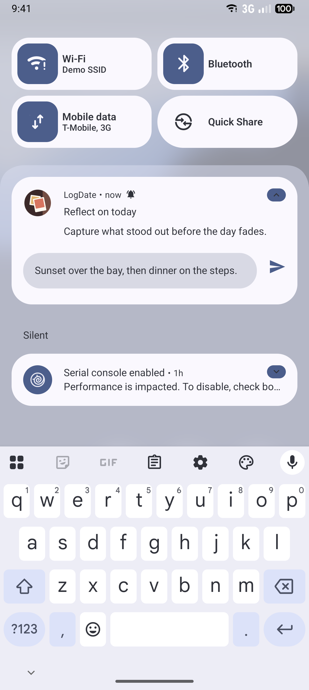
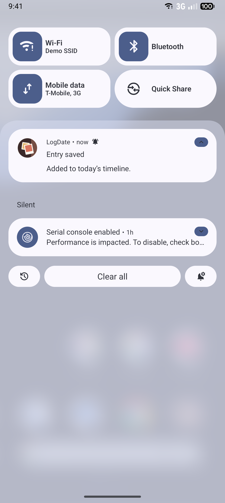

# Notification Quick Reply

Status: built, behind `NOTIFICATION_QUICK_REPLY` (Settings > Advanced > Developer tools > Feature
previews). Verified on Android 17 phone and tablet emulators.

## What it is

Android notifications can carry a **direct reply** action. Tapping it opens a text field inside the
notification itself. When the person sends, Android delivers the text to the app through a
`RemoteInput`, without opening the app.

LogDate sends **capture nudges**: gentle reminders on the `ambient_capture_nudges` channel suggesting
the person write something down. Quick reply lets them answer the nudge with an entry right there.

## What the person sees

A capture nudge gains two actions:

- **Write.** This opens a reply field labeled "Write an entry". After sending, the notification
  changes to "Entry saved: Added to today's timeline." and disappears after six seconds.
- **Record.** This opens the editor already recording. It is the same as the Record voice shortcut.

If saving fails, the notification changes to "Entry not saved", keeps the reply text, and offers
Retry. Tapping it opens a new entry in LogDate. The text is never dropped silently.

The evening reminder answered from the shade on Android 17. Write opens the reply field inside the
notification:

After sending, the same notification confirms the save without repeating what was written:

Tablet captures sit next to these with the `--tablet-api37` suffix. The failure state is covered by
`QuickReplyTest` but not captured, because forcing a save failure on a managed device needs a test
hook that does not exist yet.

## How it works

1. `AmbientPromptNotificationCoordinator`
   (`app/compose-main/src/androidMain/kotlin/app/logdate/client/ambient/`) adds:
   - a Write action with a `RemoteInput` and a mutable `PendingIntent` to a reply receiver;
   - a Record action that sends the [capture launch contract](capture-launch-contract.md) intent in
     `Voice` mode.
2. `QuickReplyReceiver` (same package) reads the text with `RemoteInput.getResultsFromIntent`, or
   from the Retry action's extra. `quickReplyNote` (commonMain, `client/ambient/QuickReply.kt`) turns
   it into a text entry stamped with the current time and time zone, or returns null for blank input,
   which just dismisses the notification.
3. The receiver saves the entry with `AddNoteUseCase`, the same use case the editor's save uses, and
   replaces the reminder with the confirmation or the failure.
4. The save runs with `goAsync()` on the app's coroutine scope, so it finishes after `onReceive`
   returns.

The coordinator learns the flag through `FeatureFlagState`, which follows one flag eagerly so code
outside coroutines can read it.

Capture reminders now use a pencil status-bar icon (`ic_notification_capture` in
`client/notifications`) instead of the platform's generic info icon.

## Flag and rollout

`NOTIFICATION_QUICK_REPLY`, off by default. With the flag off, nudges keep their current single tap
action.

## Privacy

A reply can be sent from the lock screen. The confirmation names only the action and never echoes the
entry text, so nothing private appears on the lock screen. The failure notification keeps the text so
it is not lost, but its lock-screen version (`setPublicVersion`) shows only "Entry not saved".

## How to test

- `QuickReplyTest` (compose-main, common) covers blank replies, the saved entry's text, time, and
  zone, and the shortened preview.
- An instrumented test posts a capture nudge through `AmbientPromptNotificationCoordinator` on a
  managed device and replies to it with `UiDevice`. Nudges are normally scheduled by
  `AmbientPromptScheduler`, so a test does not wait for the real schedule.

## Updating screenshots

The reply UI is system UI, so it is a Lane 2 capture. Record it with `./run screenshots:os`. It lands
in `docs/screenshots/android-os-integration/notification-quick-reply/`.
