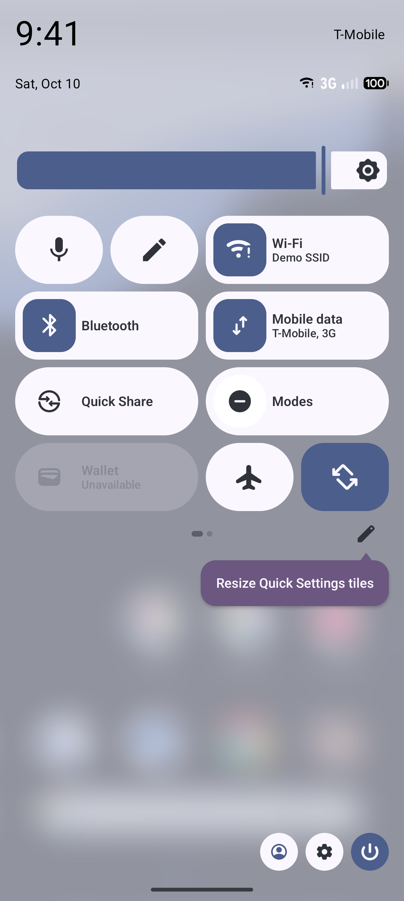
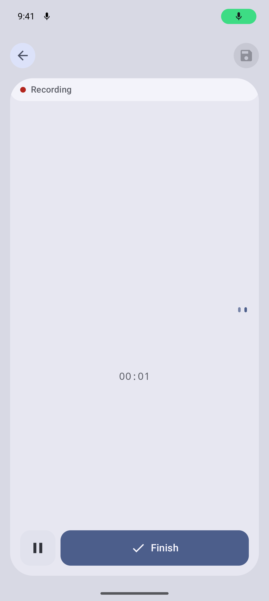
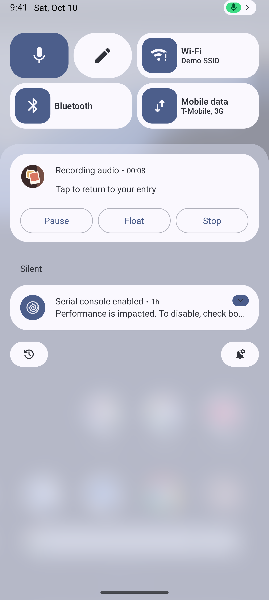

# Quick Settings Tiles

Status: built, behind `QUICK_SETTINGS_TILES` (off by default; turn it on in Settings > Advanced >
Developer tools > Feature previews). The Wear app has its own tiles; this guide covers phone and tablet
Quick Settings.

## What it is

Quick Settings is the grid of toggles that opens when someone swipes down twice from the top of the
screen. Apps can add their own tiles with a `TileService`. The person chooses which tiles to show,
from the edit screen of the shade, so a tile is a shortcut the person has deliberately placed.

A tile has a label, an optional subtitle, an icon, and a state: inactive, active, or unavailable.
The system draws it. The app's `TileService` is bound only while the shade is open, and it is told
when the tile is added, shown, hidden, or clicked.

## What the person sees

| Tile | Inactive | Active | On click |
| --- | --- | --- | --- |
| New entry | "New entry" | n/a | The shade closes and the editor opens in text mode |
| Record voice | "Record voice" | Highlighted, with "Recording" or "Paused" | Starts a voice entry, or returns to the running recording |

| Both tiles in the shade | Record voice starts a recording | The tile while recording |
| --- | --- | --- |
|  |  |  |

Android 17 shows small tiles as icons only; the tile's label stays its accessibility name.

## How it works

- **Services.** `NewEntryTileService` and `RecordVoiceTileService` live in
  `app/compose-main/src/androidMain/kotlin/app/logdate/client/tiles/CaptureTileServices.kt`. Each is
  declared in `app/android-main/src/main/AndroidManifest.xml` with the
  `android.service.quicksettings.action.QS_TILE` intent filter and the `BIND_QUICK_SETTINGS_TILE`
  permission. Tile icons are single-color vectors (`ic_tile_new_entry`, `ic_tile_record_voice`),
  because the shade tints them.
- **Opening the app.** Tapping a tile closes the shade and opens the editor through the
  [capture launch contract](capture-launch-contract.md): `mode=text` for New entry, `mode=voice` for
  Record voice. On Android 14 and later this uses `startActivityAndCollapse(PendingIntent)`, which the
  platform requires; earlier versions use the older `Intent` form.
- **Active state.** The voice tile declares `TileService.META_DATA_ACTIVE_TILE`, so Android only binds
  it when asked. `RecordVoiceTileUpdater` watches the recorder's recording and paused flows and calls
  `TileService.requestListeningState` when either changes. The tile then reads the current state and
  shows it: inactive when idle, active with "Recording" or "Paused" while a recording runs. The
  mapping lives in `CaptureTileState.kt` so it is unit-tested without Android.
- **Tapping during a recording** brings that recording's entry back instead of starting a second one.
  The recording may be in a separate editor window, so `RecordingWindowTracker` remembers the window
  in front when recording started. The tile opens the main window with `EXTRA_SHOW_RECORDING`, and
  the main window, now allowed to move windows because it is in front, brings the recording's window
  forward with `ActivityManager.AppTask.moveToFront`.

### Starting the microphone

The voice tile opens the editor in voice mode, and the editor starts recording. It does not start the
recording service from the tile itself. Android 14 and later restrict starting a microphone foreground
service from the background, and the editor path works the same on every supported version, so this
was chosen over a direct start. A direct start from the tile was not prototyped.

## Flag and rollout

`QUICK_SETTINGS_TILES`, off by default. The services are declared `android:enabled="false"`, and
`PlatformComponentToggler` enables them when the flag turns on (see the hub guide's section on flags
and manifest components). While the flag is off, the tiles do not appear in the tile picker at all.
For now the flag is turned on from Settings > Advanced > Developer tools > Feature previews.

## Privacy

Tiles show only the recording state and elapsed time, never entry content. Capture from a tile still
passes the app lock before the rest of the journal is reachable.

## How to test

- `CaptureTileStateTest` (compose-main `androidHostTest`) covers the tile appearance for idle,
  recording, and paused, and what a tap does in each.
- `PlatformComponentTogglerTest` covers enabling and disabling the services with the flag.
- On an emulator with the flag on, add the tile from the shade's edit screen.

## Updating screenshots

Tiles are system UI, so they are Lane 2 captures. `OsSurfaceScreenshotsTest` opens Quick Settings with
`UiDevice.openQuickSettings()` in demo mode. Record them with `./run screenshots:os`. They land in
`docs/screenshots/android-os-integration/quick-settings-tiles/`.
