# Widgets

Status: partial. Three home-screen widgets ship today, and pinning them from Settings works. The
capture-only lock-screen and hub widget is built, behind `LOCK_SCREEN_CAPTURE_WIDGET`. Every widget
has rendered references in light, dark, right-to-left, and 200% text.

## What it is

An app widget is a small piece of an app that lives on another surface, usually the home screen. The
launcher draws it in its own process from a `RemoteViews` description, so widget code cannot use
ordinary Compose. LogDate builds its widgets with **Jetpack Glance**. Glance looks like Compose, but
it produces `RemoteViews` behind the scenes.

Each widget has three parts:

| Part | What it is | Example |
| --- | --- | --- |
| A `GlanceAppWidget` | Describes the content | `NewEntryWidget` |
| A `GlanceAppWidgetReceiver` | The `<receiver>` Android talks to | `NewEntryWidgetReceiver` |
| An `appwidget-provider` XML | Sizes, category, preview, and configuration activity | `res/xml/new_entry_widget_info.xml` |

The XML's `widgetCategory` says where the widget can be placed. `home_screen` is the home screen.
`keyguard` is the lock screen, and on Android 16 tablets the hub, the widget space shown over the lock
screen while charging or docked.

## What the person sees

| Widget | Where | Shows | Tapping it |
| --- | --- | --- | --- |
| New entry | Home screen | Write, Record, and Camera actions, optionally over a chosen photo | Opens the editor in that mode |
| On This Day ("Memories" in the widget picker) | Home screen | A memory from this date in past years | Opens that day |
| Pinned memory ("Pinned Memory" in the widget picker) | Home screen | One memory the person chose | Opens that memory |
| Capture | Home screen, lock screen, and hub | Write, Record, and Photo actions only | Opens the editor in that mode |

The Capture widget in the Android 17 widget picker, below New Entry, whose buttons it shares:

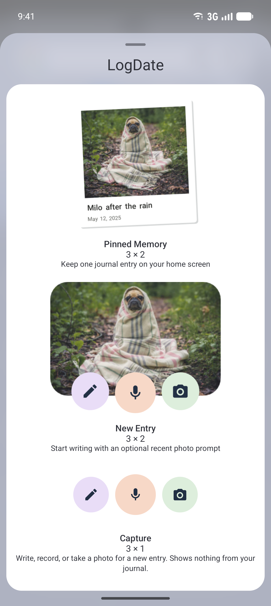

Each widget as a launcher draws it, in light, dark, right-to-left, and 200% text:

| | Light | Dark | Right-to-left | 200% text |
| --- | --- | --- | --- | --- |
| Capture | 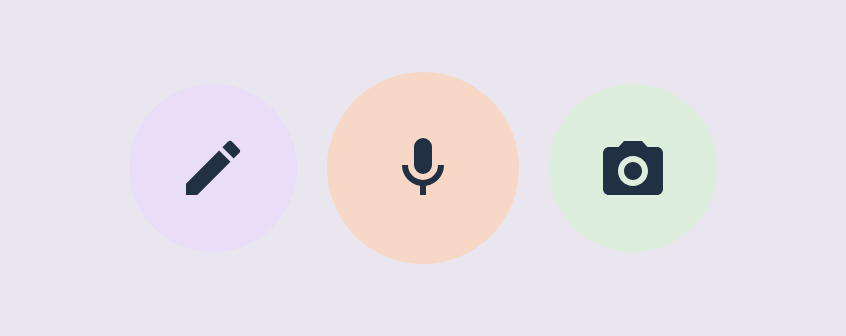 | 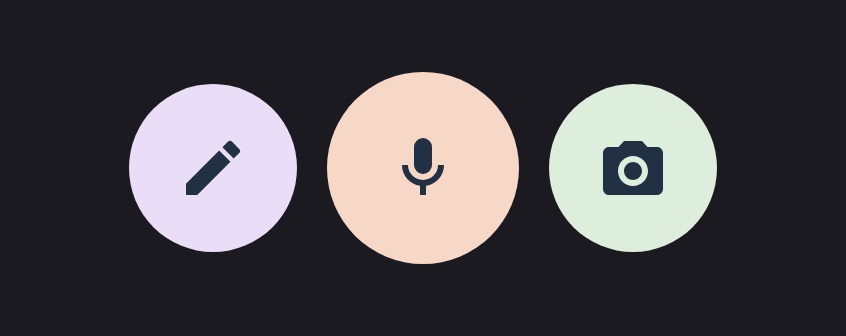 | 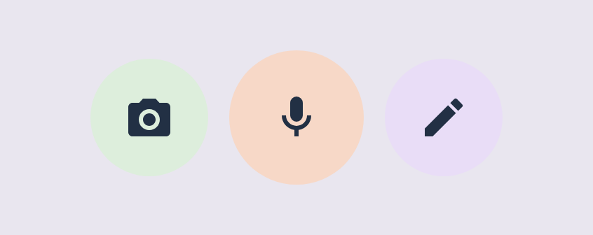 |  |
| New Entry | 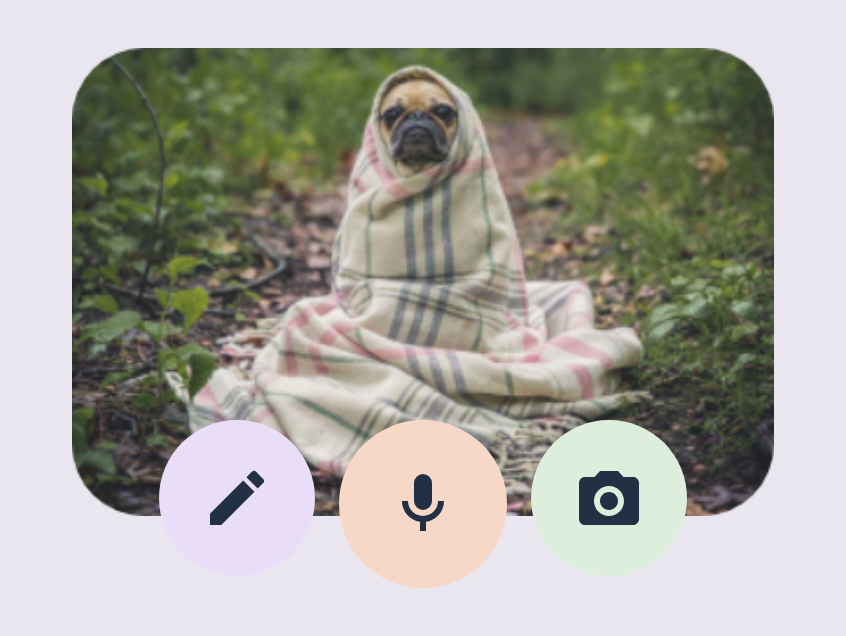 | 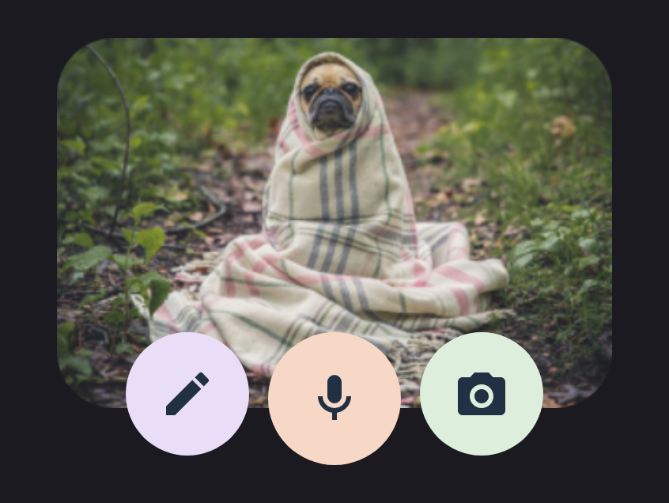 | 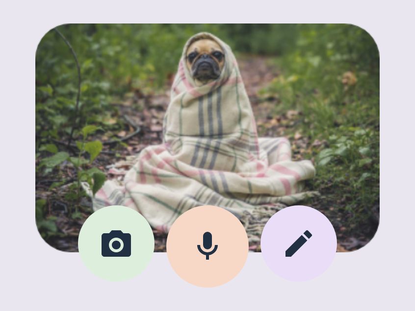 |  |
| On This Day, photo memory | 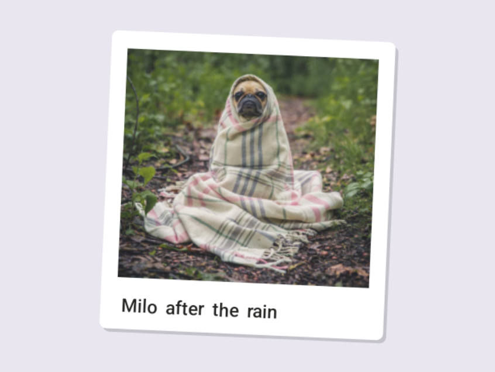 | 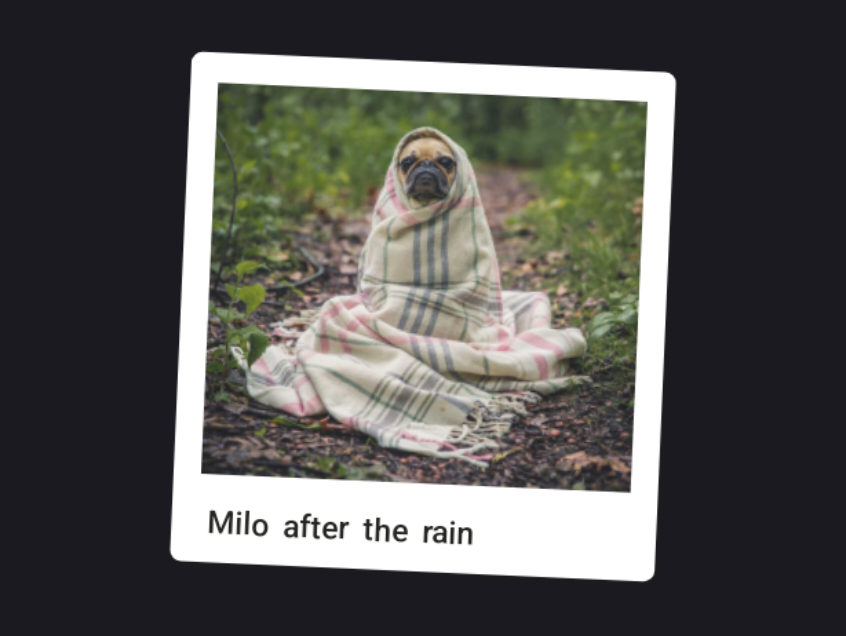 |  |  |
| On This Day, written memory | 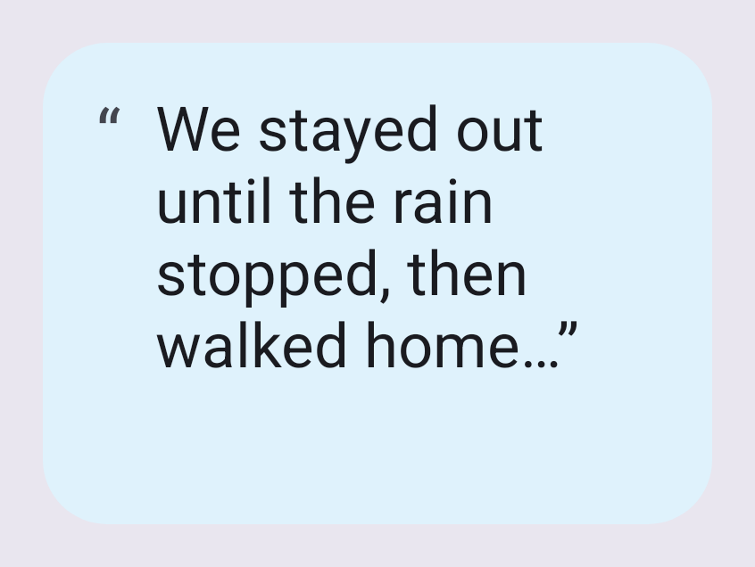 | 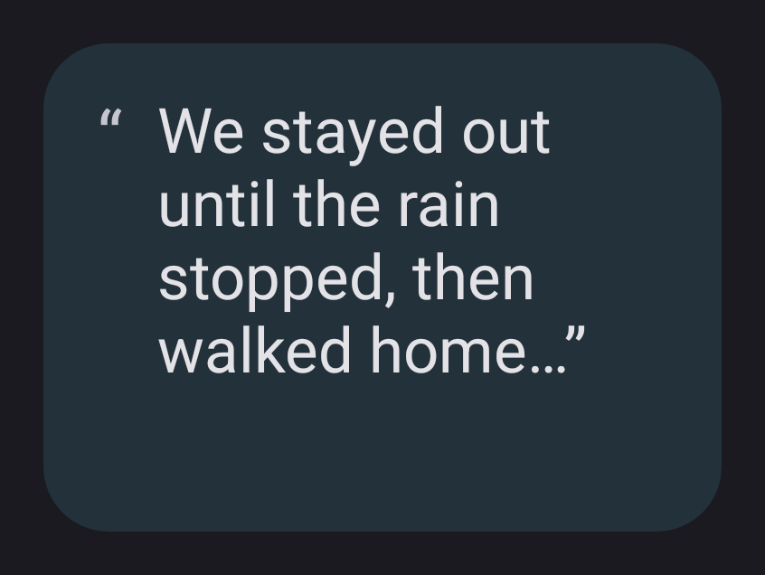 | 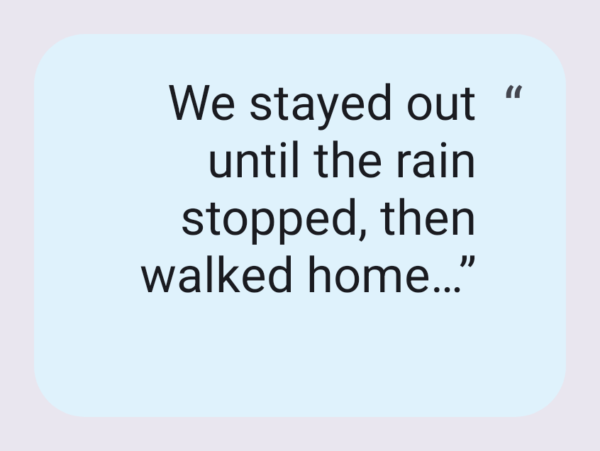 | 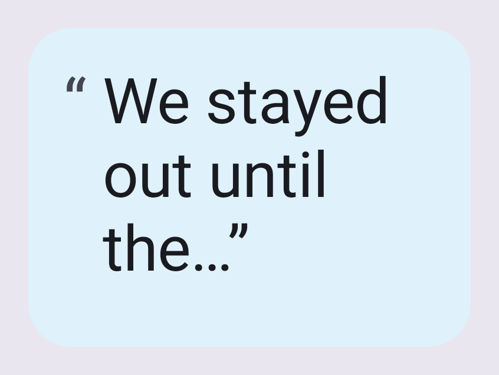 |
| Pinned memory |  | 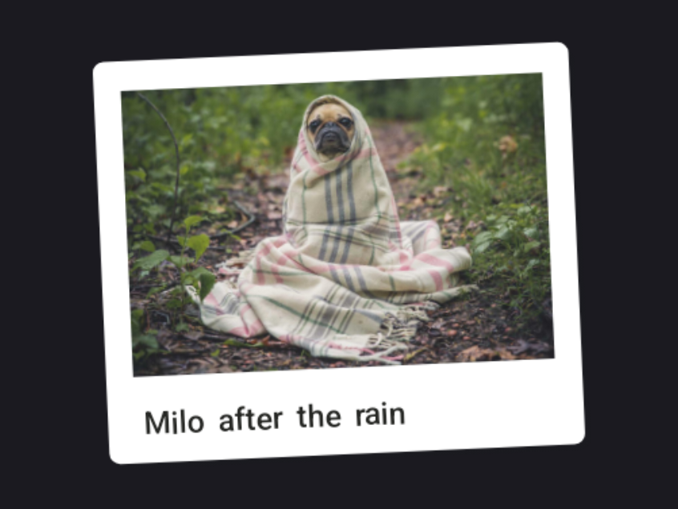 |  | 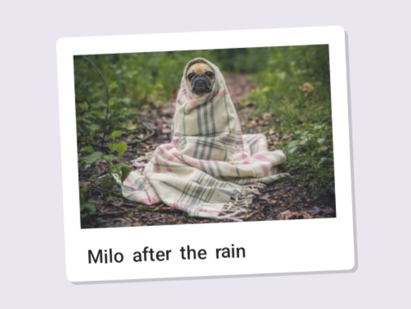 |

The capture buttons have no text, so 200% text leaves them unchanged, and their colored circles are
the same in light and dark. A memory with a photo, on On This Day or a pinned memory, is drawn as one
tilted print with its caption, because a widget cannot rotate views; the caption keeps its size at
200% text. A written memory fills the widget with as many lines as fit, ending with "…" when it is
longer. Widget text follows the system's direction, so on a right-to-left system an English memory
is right-aligned with its opening quote mark at the right, and its closing "…”" stays after its last
word. In right-to-left, the
Capture and New Entry widgets' buttons mirror, so Write is at the right.

The widget on the lock screen or the hub is not captured, because Android's emulator images cannot
show the hub. Its widget features are on, but the hub service itself is a device setting
(`config_communalServiceEnabled`) that is off on emulators and cannot be changed from the shell; a
shell resource overlay for it fails to apply. The other emulator route is a static overlay for that
setting, preinstalled in the system image's `/product/overlay` on an emulator started with
`-writable-system`; preinstalled overlays that target an SDK level below 29 may change resources the
framework does not mark overlayable. It needs a writable copy of the 5 GB system image. Placing the
widget on the hub with no emulator changes needs a tablet that offers the hub, such as a Pixel
Tablet on its dock. The keyguard category in the widget's provider XML, and the picker capture
above, are the evidence until then.

## How it works

The code lives in `client/feature/android-widgets/src/androidMain/kotlin/app/logdate/client/feature/widgets/`.

- **Launch intents.** `createWidgetLaunchIntent` in `OnThisDayWidgetContent.kt` builds the intent
  each tap sends. It sets `EXTRA_NAV_SOURCE` and, for the New entry widget, `widget_record`,
  `widget_camera`, or `widget_photo_uri` (see `WidgetNavConstants.kt`). These extras move to the
  [capture launch contract](capture-launch-contract.md); the old extras keep resolving for widgets
  already placed.
- **Setup.** Each widget has a configuration activity. Private content is protected by
  `WidgetPrivacyGate`: `requireWidgetContentAccess` asks for biometrics when the app lock is
  biometric, and refuses when it is a password.
- **Previews.** Each widget has a static picker image (`drawable-nodpi/*_widget_preview.png`) and a
  `previewLayout`. On Android 15+, `WidgetPreviewPublisher` publishes generated previews with
  `setWidgetPreviews`, so the picker shows the real widget.
- **Refresh.** `WidgetRefreshScheduler` and `OnThisDayWidgetRefreshWorker` refresh content. The
  provider XMLs set `updatePeriodMillis="0"`, so nothing refreshes on a fixed timer.
- **The capture widget.** `CaptureWidget` (`CaptureWidget.kt`) draws three buttons with the New
  entry widget's icons and colored circles, and nothing else. Its provider XML,
  `capture_widget_info.xml`, declares `home_screen|keyguard`, so Android offers it on the lock
  screen and the hub as well as the home screen; `capture_widget_preview.xml` is its picker preview.
  Each button sends the public capture action (`app.logdate.action.CAPTURE` with a mode), the same
  one launcher shortcuts and tiles send. The widget module cannot depend on the app, so the action
  and extra names are repeated in `CAPTURE_WIDGET_ACTION` and `CAPTURE_WIDGET_EXTRA_MODE`, and
  `CaptureWidgetContractTest` (app/compose-main) fails if they drift. `CaptureWidgetReceiver` is
  declared disabled and enabled by `PlatformComponentToggler` while `LOCK_SCREEN_CAPTURE_WIDGET` is
  on.
- **Pinning.** Settings > Widgets offers each widget through
  `GlanceAppWidgetManager.requestPinGlanceAppWidget` (`AndroidMemoriesWidgetInstallController`),
  only where the launcher supports pinning.

## Flag and rollout

Home-screen widgets have no flag. The lock-screen capture widget is behind `LOCK_SCREEN_CAPTURE_WIDGET`.

## Privacy

- **Lock-screen widgets never show journal content.** The capture widget shows actions only, and
  reads no journal data. On This Day and Pinned memory stay home-screen only, because their content
  is private.
- Capture from a widget still passes the app lock before the rest of the journal is reachable.

## How to test

- `commonTest` covers state mapping and serialization: `OnThisDayWidgetStateMapperTest`,
  `OnThisDayWidgetStateSerializationTest`, and `WidgetContentModelsTest`.
- `OnThisDayWidgetPreviewTest` and `WidgetSetupScreenshotsTest` render widgets and setup screens on
  managed devices.

## Updating screenshots

- **Widget layouts:** `OsSurfaceScreenshotsTest#widgetRenders` renders each widget's preview on the
  Android 17 phone managed device, through `WidgetRenders` in the instrumented tests: it composes the
  RemoteViews, inflates them with a context set to each look, and draws them to an image. This runs
  on a device rather than on the host because RemoteViews need Android's real view inflation to
  render faithfully. A widget that lists several preview sizes gets one layout per size, so the
  renderer inflates through an `AppWidgetHostView` laid out at the render size, which picks the
  matching layout as a launcher does; a plain `RemoteViews.apply` always picks the smallest. Glance's
  layouts take their direction from the default locale (`layoutDirection="locale"`), which a
  configuration context does not change, so the right-to-left render also sets the default locale
  while it draws. Record with `./run screenshots:os`.
- **Real placements:** the home screen, the lock screen, the hub, and the picker are Lane 2 captures,
  recorded with `./run screenshots:os`. They land in `docs/screenshots/android-os-integration/widgets/`.
