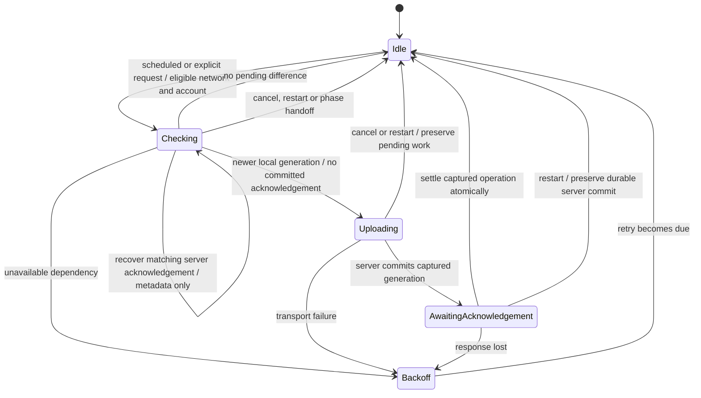
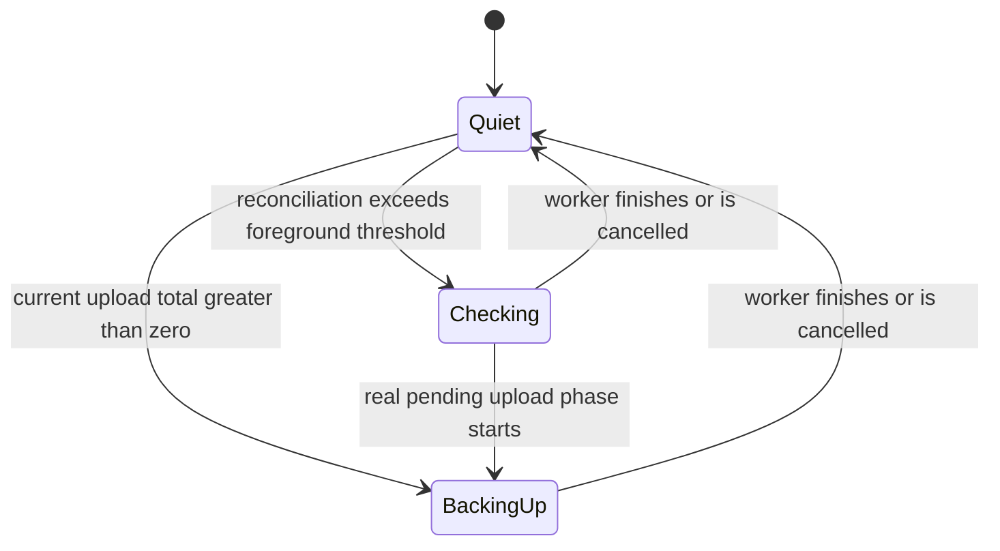

# Backup scheduling and notification model

This bounded model documents and checks the implemented sync contracts. It is **not a proof of the complete production app**, the installed Android system, or the reported device's 827-row queue.

A **check** authenticates, fetches changes/receipts and reconciles versions. A **payload backup** sends pending content. No local difference means no payload backup; checking for another device's changes is still allowed. A notification for a long check says **Checking for changes…**, not **Backing up your memories**. The latter is reserved for a positive current-run upload denominator.





## Run reproducibly

Use an already-installed official `tla2tools.jar`; the runner downloads nothing:

```sh
python3 docs/verification/backup-sync/run-model.py \
  --jar /path/to/tla2tools.jar --output /tmp/logdate-backup-tlc
```

`run-model.py` runs the fixed Wi-Fi-only and cellular-allowed configurations plus three historical-bug configurations. A historical case passes the harness only if TLC fails with its **specific expected invariant**, not a parser error, timeout or different failure. Logs, source/config hashes, tool hash, UTC execution time and explored-state counts are retained. `evidence/` contains the recorded run for this change; rerun after modifying the spec/config. State files go to the requested output directory rather than the source tree.

## Bounds and assumptions

- One content item, two successive content generations and two competing worker identities (periodic/immediate). Both can be queued; the phase mutex has one owner. This models a shared serialized phase, not the full lifetime of every WorkManager object. Interruptions overapproximate phase handoff as well as process restart/cancellation.
- Network is offline/cellular/Wi-Fi. Charging, authentication, usable keys and server availability each vary independently. Progress is one captured item, 0/1, rather than an arbitrary-size device inventory. Account/server scope and encryption context are fixed for a run; cross-account/key-rotation and cryptography are **not** proved here.
- Durable local generation, acknowledged generation and server commit survive restart. Transient ownership, notification and progress do not. New edits may occur during transfer; acknowledging an older captured generation cannot acknowledge the newer one.
- Backoff expiry abstracts elapsed time. The model does not promise a deadline or Android background execution latency. WorkManager/network callbacks and Android storage/notification APIs are external assumptions, not model-checked implementations.
- Liveness assumes the account, keys, allowed network and server eventually remain available; requests receive fair scheduling; retry timers eventually expire; and phase/acknowledgement actions are strongly fair. Infinite preemption, permanent permission/key errors, quota exhaustion, corrupt media and dead-letter decisions are excluded from this eventual-success claim. Pending work is not deleted to satisfy it.
- Charging is **not a current backup prerequisite**. `AndroidSyncManager.setupPeriodicSync` intentionally permits backup on battery; requiring charging would withhold genuine work. Stable Wi-Fi + charging + usable account/keys/server therefore implies eventual eligible pending backup under the above fairness assumptions, but not an instantaneous edge-triggered launch. The same check covers stable eligibility without needing another network edge.
- `Receipt` applies to authenticated legacy-media receipts, exact decrypted rich-draft acknowledgement reconciliation, and the new receipt-capable personal-space blob path. Personal-space intent identity is persisted before payload, scoped by owner, origin, space, complete bytes and captured encryption context. `SpaceBlobUploadReplayTest` first reproduced 4,144 bytes becoming 8,288 after a committed response was lost; its restart case now retains 4,144 total bytes. This mapping requires the new backend method and additive V55 migration; an older server is explicitly unsupported, never a positive absence result. Previously recognized receipt support cannot silently downgrade.
- The model's `Commit` is a durable completed server transaction, not a request still in flight. It does not prove zero duplicate network bytes when the server has not committed at lookup time, nor cross-process HTTP writer exclusion. The client intent mutex excludes independent callers in one process; the server transaction lock and receipt uniqueness prevent multiple committed blobs for one intent across instances. Request buffering, socket retransmission and Android/provider crashes are not model-checked.

## Properties

| Check | Meaning |
| --- | --- |
| `TypeOK` | Generations/receipts remain ordered; 0 <= completed <= captured total; valid phase/owner/state domains. |
| `NoAcknowledgedPayload` | A successfully acknowledged unchanged generation is never sent again. |
| `NoCommittedPayloadReplay` | For the modeled receipt/equality-capable paths, a lost response is reconciled without resending already-committed payload. |
| `OneTransfer` | At most one owner occupies the modeled transfer phase; concurrent triggers cannot create a second transfer. |
| `TruthfulNotification` | A backing-up notification implies a positive upload total and upload/ack phase; metadata-only reconciliation cannot claim a payload backup. |
| `EventuallyBackedUp` | Under stable dependencies and stated fairness, pending content eventually becomes acknowledged. |
| `PluggedWifiBacksUp` | The same eventual-backup property specifically under stable Android-reported Wi-Fi and charging eligibility. |

The mutex/receipt primitives are abstractions tied to source and executable tests. TLC does not verify the coroutine implementation, Room/DataStore durability, provider behavior or JVM scheduling itself.

## Model-to-code correspondence

Paths below are under `client/sync/src/` unless specified.

| Model | Source / executable evidence |
| --- | --- |
| `Edit`, `generation`, `acknowledged` | `commonMain/.../metadata/SyncMetadataService.kt`: captured operations and `settleIfCurrent`; durable implementations compare operation identity. |
| Two waiters, `BeginCheck`, `owner` | `androidMain/.../AndroidSyncManager.kt`: unique periodic/immediate work; `commonMain/.../SyncRunPhases.kt`: `syncMutex.withLock`. Concurrency/receipt tests additionally exercise shared-intent upload exclusion. |
| Stable `Ready`, `Wake` | `AndroidSyncRequests.kt`, `PeriodicSyncScheduleDecider.kt`, network-restoration callback and periodic scheduling. WorkManager evaluates level constraints; a new edge is not required. `hasDueWork` uses actual active handlers and preserves unsupported rows. |
| `Upload`, `active` | `SyncUploader`, `DraftUploader`, `SyncMediaTransfer`: capture pending operation, send exact version, preserve later edits. |
| `Receipt`, `Commit`, lost response | `cloud/DefaultCloudMediaDataSource`, `space/SpaceMediaDataSource`, `metadata/MediaUploadIntentStore`; server `SpaceBlobRoutes` / `PostgreSQLSpaceStore` atomically bind an opaque intent to a blob. `SpaceBlobUploadReplayTest` counts bytes across durable DataStore reopening, content/key changes and concurrent callers. `DraftDownloader.applyChange` adopts only an identical complete authenticated rich draft and atomically settles its current non-delete operation. |
| `Echo` | Historical `DraftDownloader` compared nanosecond local edit time with the outer millisecond timestamp; fixed comparison uses the rich draft's full edit precision. |
| `Fail`, `BackoffExpires`, `Interrupt` | `SyncRetryCoordinator`, `SyncPassLoop`, Android `SyncWorkerRetryPolicy`; cancellation propagates and pending content remains. |
| `LongCheck`, notification states | `commonMain/.../SyncForegroundRun.kt` keeps the 10-second foreground safeguard; `SyncNotificationPhase.kt` selects checking versus backing-up. Android `SyncForegroundNotification` binds that phase to the title/icon. |
| Progress | `SyncRunProgress`, `SyncStatusPublisher` and `pendingUploadsForRun`; run snapshot, not cumulative inventory. |

## Counterexamples converted into regressions

- **`BuggyEcho.cfg`** violates `NoAcknowledgedPayload`: upload/ack -> unchanged echoed draft -> false pending -> another payload. `DraftSyncIntegrationTest` reproduced four uploads rather than one; the corrected code sends zero additional payload bytes across repeated sync/reconstruction and still uploads a genuine one-nanosecond edit.
- **`BuggyLostAck.cfg`** violates `NoCommittedPayloadReplay`: commit -> lose response -> retry same payload. The executable lost-ack draft test reproduced two payload calls; exact complete rich-draft reconciliation now leaves one call and settles the outbox. Different content and deletions retain their normal handling.
- **`BuggyNotice.cfg`** violates `TruthfulNotification`: enter checking -> foreground timer -> backing-up title with total zero. `SyncForegroundNotificationTitleTest` reproduces the wrong phase, then verifies null/zero totals select checking while real pending work retains the memories title. `SyncForegroundRunTest` retains long-run protection, cancellation and notification-denial coverage.

A scoped draft regression also verifies that a queued retry in backoff produces no active upload total, preserves its content, and uploads on the next pass once the retry becomes due. Single-type and full sync use the same due/profile/transport eligibility for progress.

The separate 827-row regression proves that unsupported legacy media rows no longer constitute due upload work, remain intact, and do not prevent a real new note from being backed up.

## Release and device evidence boundaries

Phone internal 1921476/source `ab27ca25` shipped the draft-echo fix. The notification/equality-reconciliation change is separately verified and released after its own integration. Provider publication is not device installation or device-level acceptance.

The SHA-verified 1921475 AAB resource tables and DEX contained “Backing up your memories” and no compiled “Backing up your journal” phrase. The reported installed source suffix also matched 1921475. This rules out the inspected artifact containing that literal phrase; it does **not** identify what posted the observed notification. A persisted notification, channel surface, different producer or delivery mismatch is not asserted as fact. No phone data reset/reinstall was performed, and the actual notification remains unverified without matching device evidence.
